# Agentic Pipeline Report: Pham Minh Tam (R14C42023)

## Report

I ran the agentic pipeline on four 20 Newsgroups categories (`load_dataset_1`: 2,257 posts) and asked whether simple word-count features can tell the topics apart. The data was clean: no missing text (`check_missing_3`) and no duplicates (`check_duplicates_4`), but post lengths are extremely right-skewed (median 1,235 characters, maximum 60,713; `describe_data_5`). To keep the agent and API quota manageable, I worked on a random sample of 1,000 posts (`sample_data_6`, `random_state = 1`), which kept both the category proportions (within about 2 percentage points) and the shape of the length distribution (`describe_data_8`).

The document-term matrix (`build_dtm_9`, stop words removed) has 23,569 terms and is 99.51% sparse. The clearest finding is that the newsgroup email headers dominate the raw counts: the most frequent terms are "edu", "subject", "lines" and "organization" (`term_frequency_10`), and they reappear in the filters and in pattern mining. Variance filtering (`variance_12`–`14`) shrinks the vocabulary to 4,685 terms at 0.01 and 1,439 at 0.05 while keeping topical words at the top ("image", "god", "hiv", "cancer"). The correlation filters for `comp.graphics` find the topic vocabulary ("graphics", "3d", "image", "gif", "vga"), with Spearman favouring domain words and Pearson also picking up header and politeness words (`pearson_16`, `spearman_18`). The term-term correlations show clean topic clusters, for example "hiv"–"aids" at 0.94 (`feature_corr_19`).

Pattern mining on `comp.graphics` (`patterns_20`–`23` in the first session; `patterns_4`–`13` after fixing an encoding bug) mostly rediscovered the headers: "subject" occurs in all 278 comp.graphics posts and "organization" in 265. How much support a pattern gets depends heavily on the filtering method, from 278 with tf-idf down to 15 with term-frequency filtering, because the filters keep very different words. I chose `min_sup` by aiming for just over 100 patterns.

In 2D, PCA keeps only 23.40% of the variance (`reduce_dim_24`) and its axes are pulled by a handful of extremely long posts, so the four categories overlap near the origin. The non-linear methods show real structure: in t-SNE (`reduce_dim_25`) and UMAP (`reduce_dim_26`) each category occupies its own region, with the two religion groups adjacent and overlapping. Cosine similarity agrees in direction: the two same-category pairs (0.116, 0.0923) are more similar than the cross-category pair (0.0363; `cosine_28`, `cosine_29`, `cosine_31`).

Overall, word counts do separate these topics, but only after non-linear projection, and the email headers are the biggest source of noise. Stripping them before vectorising would be the first improvement.

---

## Result log

### 0. Research question and how the steps connect

My question for this run: can simple word-count features tell four newsgroup topics apart, and which words drive the difference? The four groups pair two technical/scientific topics (`comp.graphics`, `sci.med`) with two religious/philosophical ones (`alt.atheism`, `soc.religion.christian`), so I expected the technical topics to separate easily and the two religion groups to overlap.

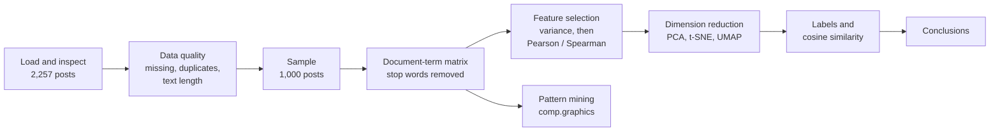

The run took **two sessions**. The first (Sun 18 Oct) ran every step; two pattern-mining calls crashed, so after fixing `mine_patterns_tool` the kernel was restarted and a second session reran the data setup and the mining (section 6). Result IDs restart in a new session, so the second-session IDs are listed separately there.

Each section below opens with the question that step answers, shows the results, and closes with what I took from it and what I decided next.

### 1. The data: source

20 Newsgroups, four categories: `comp.graphics`, `sci.med`, `alt.atheism`, `soc.religion.christian`. Raw posts keep their email-style headers (`From:`, `Subject:`, `Organization:`, `Lines:`). Counts per category are in section 2.

These four were chosen so that some pairs should be easy to separate (graphics vs medicine) and others hard (atheism vs Christianity, which discuss the same subjects from opposite sides). The raw posts still contain their email headers, and those header words turn out to matter in every later step.

### 2. Data quality: is the data usable as it is?

Before mining I checked for missing text (unusable rows), duplicates (which inflate counts and pattern support) and the distribution of post lengths (very long posts can dominate a count-based vocabulary).

#### `load_dataset_1`

The dataset was loaded with the four requested categories: 2,257 documents in total.

| Category | Documents |
|---|---:|
| soc.religion.christian | 599 |
| sci.med | 594 |
| comp.graphics | 584 |
| alt.atheism | 480 |

#### `inspect_data_2`

- Shape: 2,257 rows × 3 columns (`[2257, 3]`)
- Columns and data types:

| Column | Type |
|---|---|
| text | object |
| category | int64 |
| category_name | object |

First rows:

| | text | category | category_name |
|---:|---|---:|---|
| 0 | From: sd345@city.ac.uk (Michael Collier) Subje... | 1 | comp.graphics |
| 1 | From: ani@ms.uky.edu (Aniruddha B. Deglurkar) ... | 1 | comp.graphics |
| 2 | From: djohnson@cs.ucsd.edu (Darin Johnson) Sub... | 3 | soc.religion.christian |
| 3 | From: s0612596@let.rug.nl (M.M. Zwart) Subject... | 3 | soc.religion.christian |
| 4 | From: stanly@grok11.columbiasc.ncr.com (stanly... | 3 | soc.religion.christian |

#### `check_missing_3`

- Total documents: 2,257
- Missing count (`text` column): 0
- Missing percentage: 0.0%
- Rows with any missing values: 0

#### `check_duplicates_4`

- Initial row count (`n_initial`): 2,257
- Duplicates found (`n_duplicates`): 0
- Duplicate indices (`duplicate_indices`): `[]`
- Dropped (`dropped`): False
- Remaining row count (`n_remaining`): 2,257

#### `describe_data_5`

Text length per document (characters).

| Group | Count | Mean | Std Dev | Min | 25% | 50% (Median) | 75% | Max |
|---|---:|---:|---:|---:|---:|---:|---:|---:|
| **Overall** | 2,257 | 1,992.96 | 3,547.66 | 125.0 | 795.0 | 1,235.0 | 2,059.0 | 60,713.0 |
| alt.atheism | 480 | 2,167.30 | 3,581.70 | 228.0 | 931.5 | 1,382.5 | 2,170.75 | 51,239.0 |
| comp.graphics | 584 | 1,557.08 | 4,684.77 | 125.0 | 572.5 | 883.0 | 1,341.5 | 60,713.0 |
| sci.med | 594 | 2,008.12 | 3,360.44 | 210.0 | 849.25 | 1,238.5 | 1,943.25 | 37,009.0 |
| soc.religion.christian | 599 | 2,263.18 | 2,080.25 | 171.0 | 969.0 | 1,649.0 | 2,770.5 | 18,660.0 |

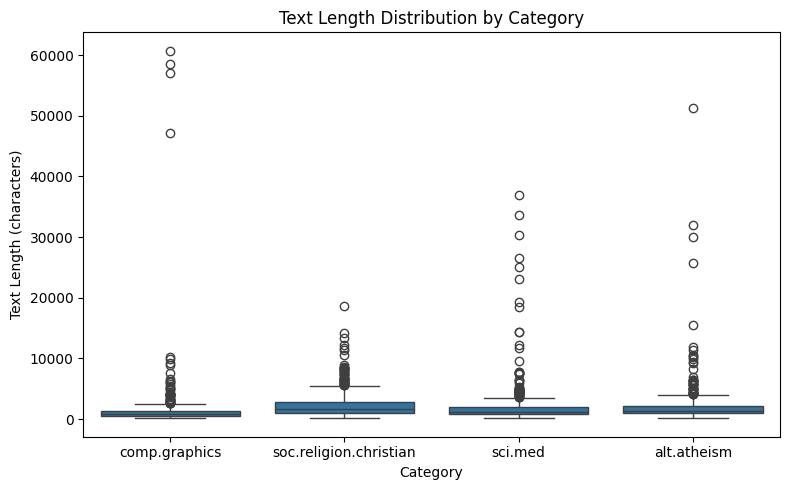

The text lengths are strongly right-skewed in every category: the mean (1,992.96 overall) is far above the median (1,235.0), and the maximum (60,713) is about 30 times the 75th percentile (2,059). In the box plot the boxes are squeezed near the bottom, with long tails of outliers. `comp.graphics` has the shortest typical posts (median 883) but the longest outliers (up to about 60,000 characters, probably posted code or file listings), while `soc.religion.christian` has the longest typical posts (median 1,649) but the smallest maximum (18,660).

**Takeaway.** With no missing values and no duplicates, nothing needed to be dropped. The skew matters later: a few posts of 30,000–60,000 characters contain far more words than the rest, so they can dominate count-based steps such as PCA (section 7).

### 3. Sampling: is a 1,000-post subset still representative?

I sampled to keep the agent's tool outputs and the API quota manageable (and to make later steps faster). The risk is that a random sample shifts the category proportions or misses the length outliers.

#### `sample_data_6`

- Initial count (`n_initial`): 2,257
- Sampled count (`n_sampled`): 1,000
- Random state: 1
- Replace: False

Datasets in later steps: the original full dataset (2,257 documents) is `load_dataset_1`; the sampled subset (1,000 documents) is `sample_data_6`.

#### `inspect_data_7`

- Shape: 1,000 rows × 3 columns (`[1000, 3]`)
- Columns and data types: `text` (object), `category` (int64), `category_name` (object)

#### `describe_data_8`

Text length per document (characters), sampled subset.

| Group | Count | Mean | Std Dev | Min | 25% | 50% (Median) | 75% | Max |
|---|---:|---:|---:|---:|---:|---:|---:|---:|
| **Overall** | 1,000 | 2,001.22 | 3,526.77 | 186.0 | 768.0 | 1,200.0 | 2,048.75 | 58,574.0 |
| alt.atheism | 214 | 2,063.89 | 2,641.09 | 228.0 | 912.25 | 1,366.0 | 2,153.25 | 30,048.0 |
| comp.graphics | 278 | 1,543.69 | 4,568.37 | 217.0 | 547.5 | 863.5 | 1,334.5 | 58,574.0 |
| sci.med | 260 | 2,299.50 | 4,060.70 | 210.0 | 851.25 | 1,231.5 | 2,105.0 | 33,601.0 |
| soc.religion.christian | 248 | 2,147.30 | 1,800.51 | 186.0 | 969.0 | 1,633.0 | 2,777.75 | 11,654.0 |

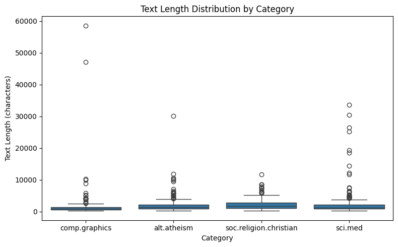

The subset keeps the shape of the full data: the same strongly right-skewed lengths (mean 2,001.22 vs median 1,200 overall), the same ordering of medians (`comp.graphics` shortest at 863.5, `soc.religion.christian` longest at 1,633), and the same box-plot pattern, with `comp.graphics` again holding the most extreme outliers (58,574). The category proportions also stay close: 21.4% / 27.8% / 26.0% / 24.8% (atheism / graphics / med / christian) in the sample vs 21.3% / 25.9% / 26.3% / 26.5% in the full data. `comp.graphics` is about 2 points over-represented and `soc.religion.christian` about 2 points under.

**Takeaway.** Simple random sampling with `random_state = 1` gave a representative and reproducible subset, so I continued with these 1,000 posts. With balanced classes like these, the proportion drift is small; on an imbalanced dataset a stratified sample would be safer.

### 4. From text to features: what does the document-term matrix contain?

`CountVectorizer` turns each post into a row and each distinct word into a column, with the value being the word's count in that post. I built it with `stop_words="english"` so that common function words ("the", "and" …) would not dominate the counts.

#### `build_dtm_9`

| Field | Value |
|---|---:|
| Number of documents (`n_documents`) | 1,000 |
| Number of terms/features (`n_terms`) | 23,569 |
| Non-zero entries (`non_zero`) | 116,250 |
| Total matrix elements (`total_elements`) | 23,569,000 |
| Sparsity (`sparsity_pct`) | 99.5068% |

Vocabulary preview: `'00'`, `'000'`, `'0000001200'`, `'00014'`, `'0007'`, `'001004'`, `'001125'`, `'001642'`, `'00196'`, `'002'`

The document-term matrix (`build_dtm_9`) is the sparse feature matrix stored in `session.feature_matrix`, with its vocabulary in `session.feature_names`.

#### `term_frequency_10`

Total unique terms (`total_terms`): 23,569. Top 10 most frequent terms (`top_terms_preview`):

| Rank | Term | Count |
|---:|---|---:|
| 1 | edu | 2,012 |
| 2 | subject | 1,097 |
| 3 | lines | 1,045 |
| 4 | organization | 966 |
| 5 | com | 911 |
| 6 | god | 857 |
| 7 | people | 755 |
| 8 | writes | 748 |
| 9 | article | 673 |
| 10 | don | 607 |

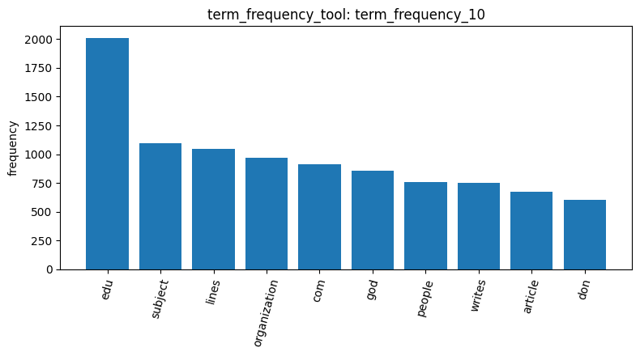

#### `dtm_heatmap_11`

A 20 × 20 slice of the matrix:

- Documents included (`n_documents`): 20 (indices 0 to 19)
- Terms included (`n_terms`): 20 (`'00'`, `'000'`, `'0000001200'`, `'00014'`, `'0007'`, `'001004'`, `'001125'`, `'001642'`, `'00196'`, `'002'`, `'003258u19250'`, `'0038'`, `'0039'`, `'00500'`, `'008561'`, `'0094'`, `'00am'`, `'00pm'`, `'01'`, `'0100'`)
- Non-zero entries in this slice:
  - Document 2 contains count 8 for term `'000'`.
  - Document 3 contains count 1 for term `'01'`.
  - Document 13 contains count 1 for term `'01'`.
- All other 397 entries in the slice are 0.

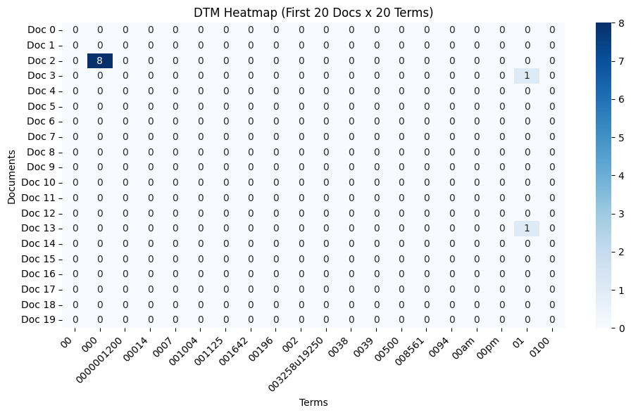

Only 3 of the 400 cells are non-zero (0.75%), close to the 0.49% density of the whole matrix (100% − 99.51%), so even this tiny slice shows how sparse the data is. The slice is the first 20 terms in alphabetical order, all number tokens ("00", "000", "0000001200" …); document 2 uses "000" 8 times. It also hints at `min_sup`: most terms occur in only a handful of the 1,000 posts, so a support threshold in the hundreds would find nothing except the header words that appear in nearly every post.

**Takeaway.** Even with stop words removed, the most frequent terms are email-header words: "edu" (2,012), "subject" (1,097), "lines" (1,045), "organization" (966), plus "com" and "writes"/"article" from reply lines. Stop-word removal does not touch these, so the later steps need to be read with the headers in mind; stripping them would be a better preprocessing step.

### 5. Feature selection: which words carry information?

I first used an unsupervised filter (variance: which words vary across posts, without labels), then supervised filters (Pearson and Spearman correlation with a one-vs-rest indicator for `comp.graphics`), then the correlations between the top words. I chose `comp.graphics` as the target because it has the most distinctive technical vocabulary of the four groups.

**Unsupervised: variance filtering**

Each plot shows the top 20 features sorted by variance, descending (20 rows plotted).

#### `variance_12`: threshold 0.0

- Total features: 23,569
- Kept: 23,569 · Removed: 0
- Kept features preview (top variances, descending): `image`, `data`, `god`, `hiv`, `edu`, `health`, `cancer`, `aids`, `available`, `tobacco`, `ftp`, `use`, `people`, `graphics`, `jesus`, `medical`, `center`, `software`, `research`, `com`
- Removed features preview: none


*No change, since no words were removed at threshold 0.00.*

#### `variance_13`: threshold 0.01

- Total features: 23,569
- Kept: 4,685 (about 19.9%) · Removed: 18,884 (about 80.1%)
- Top kept features preview (high variance): `image`, `data`, `god`, `hiv`, `edu`, `health`, `cancer`, `aids`, `available`, `tobacco`, `ftp`, `use`, `people`, `graphics`, `jesus`, `medical`, `center`, `software`, `research`, `com`
- Removed features preview (low variance): `xi`, `continental`, `gtefsd`, `harper`, `aiken`, `shadow`, `zoom`, `trait`, `246`, `xga`, `mph`, `shoulder`, `shoulders`, `leaf`, `beck`, `shin`, `morphological`, `iam`, `proportion`, `asu`

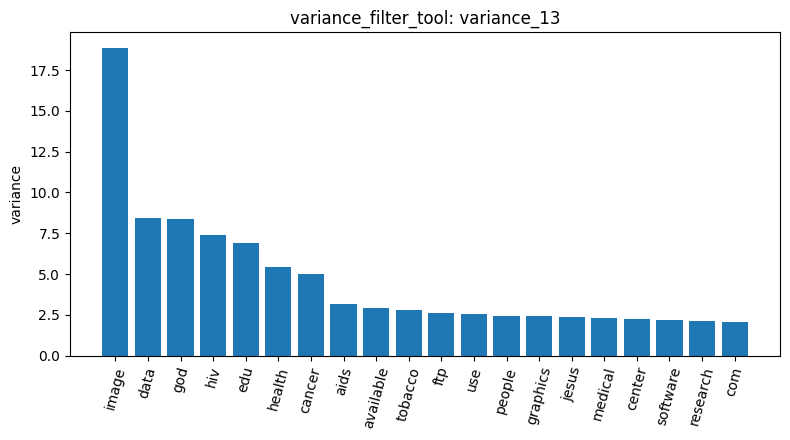

#### `variance_14`: threshold 0.05

- Total features: 23,569
- Kept: 1,439 (about 6.1% of the original vocabulary) · Removed: 22,130
- Top kept features preview (high variance): `image`, `data`, `god`, `hiv`, `edu`, `health`, `cancer`, `aids`, `available`, `tobacco`, `ftp`, `use`, `people`, `graphics`, `jesus`, `medical`, `center`, `software`, `research`, `com`
- Removed features preview (low variance): `samson`, `quantitative`, `registration`, `8bit`, `height`, `outlines`, `dizziness`, `djgpp`, `request`, `elaine`, `blooms`, `delab`, `stratus`, `camosun`, `wanted`, `allah`, `gps`, `legs`, `branch`, `blame`


| Threshold | Kept | Removed |
|---:|---:|---:|
| 0.0 (`variance_12`) | 23,569 | 0 |
| 0.01 (`variance_13`) | 4,685 | 18,884 |
| 0.05 (`variance_14`) | 1,439 | 22,130 |

**Supervised: correlation with `comp.graphics` (one-vs-rest)**

#### `pearson_15`: threshold 0.0

- Total features: 23,569
- Kept: 23,569 · Removed: 0
- Top kept features preview (sorted by Pearson correlation): `graphics`, `thanks`, `writes`, `people`, `advance`, `animation`, `vga`, `files`, `keywords`, `card`, `host`, `video`, `looking`, `screen`, `computer`, `article`, `colors`, `nntp`, `rutgers`, `running`
- Removed features preview: none

#### `pearson_16`: threshold 0.05

- Total features: 23,569
- Kept: 6,761 · Removed: 16,808
- Top kept features preview: `graphics`, `thanks`, `writes`, `people`, `advance`, `animation`, `vga`, `files`, `keywords`, `card`, `host`, `video`, `looking`, `screen`, `computer`, `article`, `colors`, `nntp`, `rutgers`, `running`
- Removed features preview: `questions`, `produced`, `conclude`, `german`, `states`, `bacterial`, `certainty`, `legitimate`, `potential`, `ericsson`, `black`, `mentioned`, `options`, `solve`, `complicated`, `enjoy`, `offers`, `diets`, `caught`, `denial`

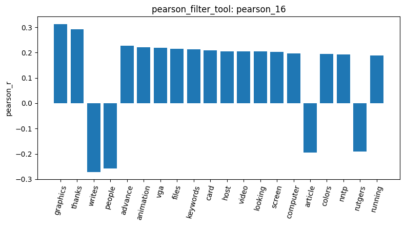

*Top 20 Pearson-correlated features for target class comp.graphics (20 rows plotted).*

#### `spearman_17`: threshold 0.0

- Total DTM features: 23,569
- Evaluated features: 1,500 (the top 1,500 by variance out of 23,569)
- Kept: 1,500 · Removed: 0
- Top kept features preview (rank-correlation order): `graphics`, `people`, `files`, `program`, `god`, `thanks`, `writes`, `image`, `windows`, `ftp`, `3d`, `images`, `color`, `file`, `package`, `format`, `gif`, `vga`, `video`, `software`

#### `spearman_18`: threshold 0.05

- Evaluated features: 1,500
- Kept: 913 · Removed: 587
- Top kept features preview: `graphics`, `people`, `files`, `program`, `god`, `thanks`, `writes`, `image`, `windows`, `ftp`, `3d`, `images`, `color`, `file`, `package`, `format`, `gif`, `vga`, `video`, `software`
- Removed features preview: `area`, `advice`, `technologies`, `internet`, `order`, `similar`, `stuff`, `non`, `contact`, `east`, `ask`, `friend`, `diabetes`, `bush`, `divorce`, `gifts`, `halat`, `compromise`, `uhunix`, `bath`

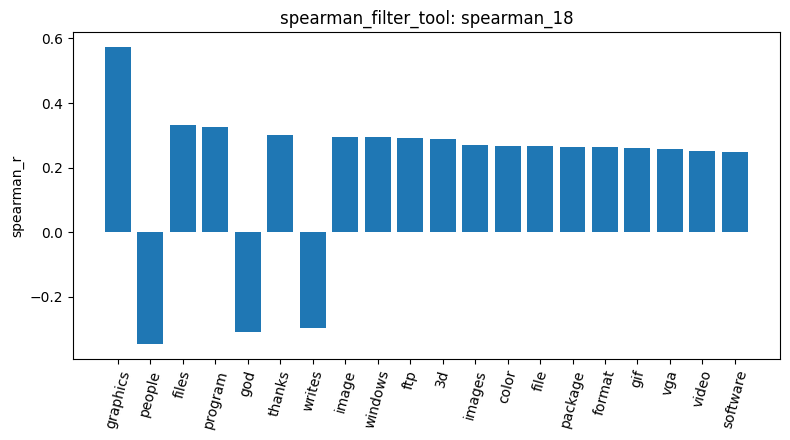

*Top 20 Spearman rank-correlated features for target class comp.graphics (20 rows plotted).*

**Pearson vs Spearman.** The two lists share the core topic words ("graphics", "files", "image", "vga", "video"), but Pearson also ranks header and politeness words high ("thanks", "writes", "advance" from "thanks in advance", "keywords", "host", "nntp", "rutgers"). Pearson works on raw counts, so words that appear often in a group of posts (header fields, sign-offs) get a strong linear correlation. Spearman works on ranks and is less sensitive to count spikes, so it favours words that are consistently present in the topic ("3d", "images", "color", "gif", "format", "package"). One caveat: Spearman was computed only on the 1,500 highest-variance terms (`max_terms = 1500`), so rare header tokens may be missing from its list partly for that reason.

**Feature-feature correlation**

#### `feature_corr_19`

A 20 × 20 correlation matrix across the top 20 variance terms: `image`, `data`, `god`, `hiv`, `edu`, `health`, `cancer`, `aids`, `available`, `tobacco`, `ftp`, `use`, `people`, `graphics`, `jesus`, `medical`, `center`, `software`, `research`, `com`.

**Strong positive term-pair correlations**

| Term pair | Correlation | Note |
|---|---:|---|
| available & ftp | 0.9395 | software/download phrase context |
| hiv & aids | 0.937 | very strong correlation between specific medical terms |
| data & ftp | 0.9275 | |
| data & available | 0.9168 | |
| cancer & center | 0.8806 | |
| health & tobacco | 0.8393 | |
| data & software | 0.8293 | |
| image & software | 0.7877 | |

**Topic cluster separation:** medical terms (`hiv`, `aids`, `cancer`, `medical`, `health`) show near-zero or slightly negative correlation with religious terms (`god`, `jesus`; e.g. hiv & god = -0.0105) and graphics terms (graphics & god = -0.0504).

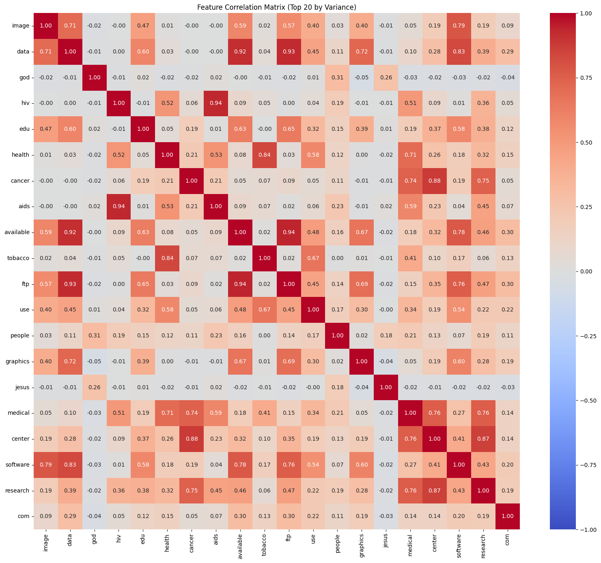

**Takeaway.** Variance keeps topical words at the top but also "edu" and "com"; Pearson lets header words through; Spearman gives the cleanest topic vocabulary. The term-term heatmap shows real topic structure: medical terms ("hiv", "aids", "cancer", "health") correlate with each other and not with religious terms ("god", "jesus"; e.g. "hiv"–"god" −0.01). Some of the strongest pairs, though, are phrase effects ("available"–"ftp" 0.94, "data"–"ftp" 0.93), words repeated together in a few long posts.

### 6. Pattern mining: which words occur together in `comp.graphics` posts?

A frequent pattern is a set of words that appear together in many posts of one category; its support is the number of such posts. I mined `comp.graphics` only, to see whether its posts share word combinations beyond the single topic words.

**Session 1: variance filtering**

#### `patterns_20`: top-k, k = 100

Total patterns mined: 100. Top 20 patterns by support:

| # | Pattern | Support |
|---:|---|---:|
| 1 | `subject` | 278 |
| 2 | `organization` | 265 |
| 3 | `subject`, `organization` | 265 |
| 4 | `got` | 36 |
| 5 | `subject`, `got` | 36 |
| 6 | `advance` | 35 |
| 7 | `hi` | 35 |
| 8 | `subject`, `advance` | 35 |
| 9 | `subject`, `hi` | 35 |
| 10 | `newsreader` | 34 |
| 11 | `subject`, `newsreader` | 34 |
| 12 | `anybody` | 33 |
| 13 | `tin` | 33 |
| 14 | `organization`, `subject`, `advance` | 33 |
| 15 | `organization`, `subject`, `hi` | 33 |
| 16 | `subject`, `anybody` | 33 |
| 17 | `subject`, `tin` | 33 |
| 18 | `organization`, `advance` | 33 |
| 19 | `organization`, `hi` | 33 |
| 20 | `organization`, `subject`, `got` | 32 |

Top-k shows the support range: after the header words ("subject" 278, i.e. every comp.graphics post in the sample, and "organization" 265), support drops quickly to the 30s for words like "got", "advance" and "hi". I chose `min_sup = 20` (about 7% of the 278 posts) to stay below those values and get a workable number of patterns; it gave 105 frequent patterns, just over my target of 100.

#### `patterns_21`: FP-Growth, `min_sup` = 20

Total patterns mined: 105. First 20 patterns:

| # | Pattern | Support |
|---:|---|---:|
| 1 | `20` | 20 |
| 2 | `20`, `subject` | 20 |
| 3 | `right` | 20 |
| 4 | `right`, `subject` | 20 |
| 5 | `right`, `organization` | 20 |
| 6 | `subject`, `right`, `organization` | 20 |
| 7 | `kind` | 20 |
| 8 | `kind`, `subject` | 20 |
| 9 | `kind`, `organization` | 20 |
| 10 | `subject`, `kind`, `organization` | 20 |
| 11 | `thing` | 21 |
| 12 | `thing`, `subject` | 21 |
| 13 | `thing`, `organization` | 21 |
| 14 | `subject`, `thing`, `organization` | 21 |
| 15 | `possible` | 21 |
| 16 | `possible`, `subject` | 21 |
| 17 | `possible`, `organization` | 21 |
| 18 | `subject`, `possible`, `organization` | 21 |
| 19 | `sorry` | 21 |
| 20 | `sorry`, `subject` | 21 |

#### `patterns_22`: MaxFP-Growth, `min_sup` = 20

Total maximal patterns mined: 24. Preview (top 20):

| # | Pattern | Support |
|---:|---|---:|
| 1 | `subject`, `organization`, `kind` | 20 |
| 2 | `subject`, `organization`, `right` | 20 |
| 3 | `subject`, `20` | 20 |
| 4 | `subject`, `organization`, `doesn` | 21 |
| 5 | `subject`, `organization`, `sorry` | 21 |
| 6 | `subject`, `organization`, `possible` | 21 |
| 7 | `subject`, `organization`, `thing` | 21 |
| 8 | `subject`, `organization`, `better` | 22 |
| 9 | `subject`, `organization`, `convert` | 22 |
| 10 | `subject`, `organization`, `summary` | 22 |
| 11 | `subject`, `organization`, `post` | 23 |
| 12 | `subject`, `organization`, `dept` | 22 |
| 13 | `subject`, `organization`, `13` | 23 |
| 14 | `subject`, `organization`, `actually` | 24 |
| 15 | `subject`, `organization`, `interested` | 25 |
| 16 | `subject`, `organization`, `appreciated` | 26 |
| 17 | `subject`, `organization`, `able` | 24 |
| 18 | `subject`, `organization`, `11` | 27 |
| 19 | `subject`, `organization`, `wrote` | 28 |
| 20 | `subject`, `organization`, `newsreader`, `tin` | 28 |

#### `patterns_23`: MaxFP-Growth, `min_sup` = 15

Total maximal patterns mined: 56. Preview (top 20):

| # | Pattern | Support |
|---:|---|---:|
| 1 | `subject`, `organization`, `going` | 15 |
| 2 | `subject`, `organization`, `college` | 15 |
| 3 | `subject`, `organization`, `quite` | 15 |
| 4 | `subject`, `organization`, `reference` | 15 |
| 5 | `subject`, `window` | 15 |
| 6 | `subject`, `organization`, `state` | 15 |
| 7 | `subject`, `organization`, `product` | 15 |
| 8 | `subject`, `organization`, `note` | 15 |
| 9 | `subject`, `organization`, `yes` | 15 |
| 10 | `subject`, `organization`, `seen` | 15 |
| 11 | `subject`, `life` | 15 |
| 12 | `subject`, `organization`, `access` | 16 |
| 13 | `subject`, `organization`, `following` | 16 |
| 14 | `subject`, `organization`, `14` | 16 |
| 15 | `subject`, `organization`, `course` | 16 |
| 16 | `subject`, `organization`, `heard` | 16 |
| 17 | `subject`, `fine` | 16 |
| 18 | `subject`, `organization`, `sure` | 17 |
| 19 | `subject`, `organization`, `uucp` | 17 |
| 20 | `subject`, `organization`, `probably` | 17 |

**Order of the MaxFP-Growth output.** In the first session the MaxFP-Growth results came out in ascending support. According to the agent this is the order in which PAMI discovers maximal patterns, working up from the least frequent items; I did not verify that. After I fixed the tool (second session), results are sorted by support descending. MaxFP-Growth keeps only maximal patterns (no frequent superset), so `min_sup = 20` gives 24 patterns instead of 105, and lowering it to 15 gives 56; almost all are "subject, organization" plus one other word.

**Session 2: `tfidf` and `term_frequency` filtering**

The `tfidf` and `term_frequency` mining calls in the first session failed with a `UnicodeDecodeError` (a non-ASCII character in the transactional file PAMI reads). After fixing `mine_patterns_tool`, I restarted the kernel and rebuilt the data in a **second session**, so these results use a new set of result IDs. `load_dataset_1` appears in both sessions.

**Second-session setup**

| Result ID | Step | Parameters / output |
|---|---|---|
| `load_dataset_1` | Load 20-newsgroups | Same four categories; 2,257 documents (599 / 594 / 584 / 480) |
| `sample_data_2` | Sample the data | `n = 1000`, `random_state = 1`, `replace = False` (same sample as `sample_data_6` in the first session) |

`mine_patterns_tool` does not use the document-term matrix: it filters the posts of the chosen category and builds its own vectorizer (with stop words removed), then applies the chosen vocabulary filter before mining. So the second-session matrix settings do not affect these results.

**Choosing `min_sup` and `k`**

I ran several settings per filtering method and algorithm to find an appropriate `min_sup` (or `k`). The aim was to get more than 100 mined patterns, since a small result (for example 0 or 29 patterns) gives too little to interpret. The table lists every run in order.

| Result ID | Filtering method | Algorithm | Setting | Patterns mined | Highest support in preview | More than 100 patterns? |
|---|---|---|---|---:|---:|---|
| `patterns_4` | tfidf | topk | `k = 100` | 100 | 278 | n/a (`k` fixed at 100) |
| `patterns_5` | tfidf | fpgrowth | `min_sup = 20` | 6,759 | 278 | Yes |
| `patterns_6` | tfidf | fpgrowth | `min_sup = 50` | 463 | 278 | Yes |
| `patterns_7` | tfidf | maxfpgrowth | `min_sup = 50` | 29 | 72 | No |
| `patterns_8` | tfidf | maxfpgrowth | `min_sup = 20` | 352 | 40 | Yes |
| `patterns_9` | term_frequency | topk | `k = 100` | 100 | 15 | n/a (`k` fixed at 100) |
| `patterns_10` | term_frequency | fpgrowth | `min_sup = 20` | 0 | none | No |
| `patterns_11` | term_frequency | fpgrowth | `min_sup = 10` | 61 | 15 | No |
| `patterns_12` | term_frequency | fpgrowth | `min_sup = 8` | 184 | 15 | Yes |
| `patterns_13` | term_frequency | maxfpgrowth | `min_sup = 8` | 180 | 15 | Yes |

Previews below are in the order the tool returned them (support descending).

#### `patterns_4`: tf-idf, top-k, k = 100

Total patterns mined: 100. Top 20 patterns:

| # | Pattern | Support |
|---:|---|---:|
| 1 | `lines` | 278 |
| 2 | `subject` | 278 |
| 3 | `lines`, `subject` | 278 |
| 4 | `organization` | 265 |
| 5 | `subject`, `lines`, `organization` | 265 |
| 6 | `lines`, `organization` | 265 |
| 7 | `subject`, `organization` | 265 |
| 8 | `edu` | 159 |
| 9 | `subject`, `lines`, `edu` | 159 |
| 10 | `lines`, `edu` | 159 |
| 11 | `subject`, `edu` | 159 |
| 12 | `organization`, `subject`, `lines`, `edu` | 153 |
| 13 | `organization`, `lines`, `edu` | 153 |
| 14 | `organization`, `subject`, `edu` | 153 |
| 15 | `organization`, `edu` | 153 |
| 16 | `university` | 136 |
| 17 | `subject`, `lines`, `university` | 136 |
| 18 | `lines`, `university` | 136 |
| 19 | `subject`, `university` | 136 |
| 20 | `organization`, `subject`, `lines`, `university` | 134 |

#### `patterns_5`: tf-idf, FP-Growth, `min_sup` = 20

Total patterns mined: 6,759. Top 20 patterns:

| # | Pattern | Support |
|---:|---|---:|
| 1 | `lines` | 278 |
| 2 | `lines`, `subject` | 278 |
| 3 | `subject` | 278 |
| 4 | `organization` | 265 |
| 5 | `subject`, `organization` | 265 |
| 6 | `lines`, `subject`, `organization` | 265 |
| 7 | `lines`, `organization` | 265 |
| 8 | `edu`, `lines` | 159 |
| 9 | `edu` | 159 |
| 10 | `lines`, `edu`, `subject` | 159 |
| 11 | `edu`, `subject` | 159 |
| 12 | `lines`, `subject`, `edu`, `organization` | 153 |
| 13 | `subject`, `edu`, `organization` | 153 |
| 14 | `edu`, `organization` | 153 |
| 15 | `lines`, `edu`, `organization` | 153 |
| 16 | `university`, `subject` | 136 |
| 17 | `university`, `lines` | 136 |
| 18 | `lines`, `university`, `subject` | 136 |
| 19 | `university` | 136 |
| 20 | `lines`, `subject`, `university`, `organization` | 134 |

#### `patterns_6`: tf-idf, FP-Growth, `min_sup` = 50

Total patterns mined: 463. Top 20 patterns:

| # | Pattern | Support |
|---:|---|---:|
| 1 | `lines`, `subject` | 278 |
| 2 | `subject` | 278 |
| 3 | `lines` | 278 |
| 4 | `lines`, `subject`, `organization` | 265 |
| 5 | `subject`, `organization` | 265 |
| 6 | `lines`, `organization` | 265 |
| 7 | `organization` | 265 |
| 8 | `lines`, `edu`, `subject` | 159 |
| 9 | `edu` | 159 |
| 10 | `edu`, `lines` | 159 |
| 11 | `edu`, `subject` | 159 |
| 12 | `lines`, `subject`, `edu`, `organization` | 153 |
| 13 | `edu`, `organization` | 153 |
| 14 | `subject`, `edu`, `organization` | 153 |
| 15 | `lines`, `edu`, `organization` | 153 |
| 16 | `lines`, `university`, `subject` | 136 |
| 17 | `university` | 136 |
| 18 | `university`, `lines` | 136 |
| 19 | `university`, `subject` | 136 |
| 20 | `subject`, `university`, `organization` | 134 |

#### `patterns_7`: tf-idf, MaxFP-Growth, `min_sup` = 50

Total patterns mined: 29. Top 20 maximal patterns:

| # | Pattern | Support |
|---:|---|---:|
| 1 | `lines`, `subject`, `organization`, `does` | 72 |
| 2 | `lines`, `subject`, `organization`, `edu`, `posting`, `host`, `nntp` | 69 |
| 3 | `lines`, `subject`, `organization`, `computer` | 67 |
| 4 | `lines`, `subject`, `organization`, `com` | 67 |
| 5 | `lines`, `subject`, `organization`, `use` | 66 |
| 6 | `lines`, `subject`, `organization`, `edu`, `graphics` | 65 |
| 7 | `lines`, `subject`, `organization`, `edu`, `article` | 63 |
| 8 | `lines`, `subject`, `organization`, `writes`, `article` | 61 |
| 9 | `lines`, `subject`, `organization`, `university`, `posting`, `host`, `nntp` | 61 |
| 10 | `lines`, `subject`, `organization`, `distribution` | 60 |
| 11 | `lines`, `subject`, `organization`, `program` | 58 |
| 12 | `lines`, `subject`, `organization`, `don` | 58 |
| 13 | `lines`, `subject`, `organization`, `help` | 58 |
| 14 | `lines`, `subject`, `organization`, `just` | 58 |
| 15 | `lines`, `subject`, `organization`, `edu`, `writes` | 58 |
| 16 | `lines`, `subject`, `organization`, `edu`, `know` | 56 |
| 17 | `lines`, `subject`, `organization`, `university`, `graphics` | 55 |
| 18 | `lines`, `subject`, `organization`, `good` | 55 |
| 19 | `lines`, `subject`, `posting`, `graphics` | 52 |
| 20 | `lines`, `subject`, `looking` | 52 |

#### `patterns_8`: tf-idf, MaxFP-Growth, `min_sup` = 20

Total patterns mined: 352. Top 20 maximal patterns:

| # | Pattern | Support |
|---:|---|---:|
| 1 | `lines`, `subject`, `organization`, `edu`, `university`, `know` | 40 |
| 2 | `lines`, `subject`, `organization`, `windows` | 34 |
| 3 | `lines`, `subject`, `organization`, `edu`, `university`, `like` | 34 |
| 4 | `lines`, `subject`, `organization`, `used` | 33 |
| 5 | `lines`, `subject`, `organization`, `hi` | 33 |
| 6 | `lines`, `subject`, `organization`, `work` | 33 |
| 7 | `lines`, `subject`, `organization`, `got` | 32 |
| 8 | `lines`, `subject`, `organization`, `images` | 32 |
| 9 | `lines`, `subject`, `organization`, `code` | 31 |
| 10 | `lines`, `subject`, `organization`, `edu`, `graphics`, `know` | 31 |
| 11 | `lines`, `subject`, `organization`, `posting`, `host`, `nntp`, `don` | 31 |
| 12 | `lines`, `subject`, `organization`, `know`, `thanks` | 30 |
| 13 | `lines`, `subject`, `organization`, `edu`, `university`, `writes`, `article` | 30 |
| 14 | `lines`, `subject`, `organization`, `read` | 30 |
| 15 | `lines`, `subject`, `organization`, `know`, `com` | 30 |
| 16 | `lines`, `subject`, `organization`, `edu`, `mail` | 30 |
| 17 | `lines`, `subject`, `organization`, `point` | 29 |
| 18 | `lines`, `subject`, `organization`, `edu`, `university`, `computer` | 29 |
| 19 | `lines`, `subject`, `organization`, `edu`, `university`, `does` | 29 |
| 20 | `lines`, `subject`, `organization`, `graphics`, `help` | 29 |

#### `patterns_9`: term frequency, top-k, k = 100

Total patterns mined: 100. Top 20 patterns:

| # | Pattern | Support |
|---:|---|---:|
| 1 | `seen` | 15 |
| 2 | `ideas` | 14 |
| 3 | `place` | 14 |
| 4 | `big` | 14 |
| 5 | `writing` | 14 |
| 6 | `having` | 14 |
| 7 | `wanted` | 14 |
| 8 | `trying` | 13 |
| 9 | `greatly` | 13 |
| 10 | `maybe` | 13 |
| 11 | `recently` | 12 |
| 12 | `network` | 12 |
| 13 | `33` | 12 |
| 14 | `needs` | 12 |
| 15 | `93` | 12 |
| 16 | `bad` | 12 |
| 17 | `come` | 12 |
| 18 | `human` | 12 |
| 19 | `modes` | 12 |
| 20 | `services` | 12 |

#### `patterns_10`: term frequency, FP-Growth, `min_sup` = 20

Total patterns mined: 0. No patterns found at or above support threshold 20.

#### `patterns_11`: term frequency, FP-Growth, `min_sup` = 10

Total patterns mined: 61. Top 20 patterns:

| # | Pattern | Support |
|---:|---|---:|
| 1 | `seen` | 15 |
| 2 | `having` | 14 |
| 3 | `big` | 14 |
| 4 | `wanted` | 14 |
| 5 | `place` | 14 |
| 6 | `writing` | 14 |
| 7 | `ideas` | 14 |
| 8 | `trying` | 13 |
| 9 | `maybe` | 13 |
| 10 | `greatly` | 13 |
| 11 | `needs` | 12 |
| 12 | `come` | 12 |
| 13 | `network` | 12 |
| 14 | `bad` | 12 |
| 15 | `93` | 12 |
| 16 | `33` | 12 |
| 17 | `services` | 12 |
| 18 | `thank` | 12 |
| 19 | `understand` | 12 |
| 20 | `recently` | 12 |

#### `patterns_12`: term frequency, FP-Growth, `min_sup` = 8

Total patterns mined: 184. Top 20 patterns:

| # | Pattern | Support |
|---:|---|---:|
| 1 | `seen` | 15 |
| 2 | `place` | 14 |
| 3 | `writing` | 14 |
| 4 | `wanted` | 14 |
| 5 | `ideas` | 14 |
| 6 | `big` | 14 |
| 7 | `having` | 14 |
| 8 | `trying` | 13 |
| 9 | `greatly` | 13 |
| 10 | `maybe` | 13 |
| 11 | `come` | 12 |
| 12 | `needs` | 12 |
| 13 | `33` | 12 |
| 14 | `network` | 12 |
| 15 | `bad` | 12 |
| 16 | `93` | 12 |
| 17 | `recently` | 12 |
| 18 | `thank` | 12 |
| 19 | `human` | 12 |
| 20 | `man` | 12 |

#### `patterns_13`: term frequency, MaxFP-Growth, `min_sup` = 8

Total patterns mined: 180. Top 20 maximal patterns:

| # | Pattern | Support |
|---:|---|---:|
| 1 | `seen` | 15 |
| 2 | `having` | 14 |
| 3 | `wanted` | 14 |
| 4 | `writing` | 14 |
| 5 | `big` | 14 |
| 6 | `ideas` | 14 |
| 7 | `place` | 14 |
| 8 | `maybe` | 13 |
| 9 | `greatly` | 13 |
| 10 | `trying` | 13 |
| 11 | `man` | 12 |
| 12 | `understand` | 12 |
| 13 | `come` | 12 |
| 14 | `services` | 12 |
| 15 | `human` | 12 |
| 16 | `modes` | 12 |
| 17 | `thank` | 12 |
| 18 | `network` | 12 |
| 19 | `93` | 12 |
| 20 | `needs` | 12 |

**Why support varies so much.** Support is always counted the same way (number of comp.graphics posts containing the whole pattern), but each filter keeps different words. Tf-idf keeps the frequent header words ("lines", "subject", "organization", "edu", "university"), so its supports reach 278 and patterns like "lines, subject, organization" cover nearly every post; at `min_sup = 20` that gives 6,759 patterns, because every combination of header words is frequent. Term-frequency filtering appears to drop the most frequent words, leaving ordinary mid-frequency words ("seen", "ideas", "place"), so the highest support is only 15 and `min_sup = 20` finds nothing. Variance sits in between. MaxFP-Growth then collapses each family of header combinations into its largest set, which is why its counts are much smaller (29 at 50 vs 463 for FP-Growth).

**Takeaway.** Pattern mining on raw newsgroup posts mostly rediscovers the email headers ("subject", "organization", "lines", "nntp", "posting", "host"). The few topical patterns ("graphics", "images", "windows", "code") sit inside header combinations. I set `min_sup` per run by aiming for just over 100 patterns, which is a practical rule but means the threshold depends on the filter. Stripping headers before mining would make the patterns far more informative.

### 7. Dimension reduction: do the four categories separate?

23,569 word columns can't be plotted directly, so I projected the posts to 2D: PCA (a linear projection that keeps as much global variance as possible) and t-SNE and UMAP (non-linear methods that keep local neighbourhoods). All three used `random_state = 42`.

#### `reduce_dim_24`: PCA

- Components (`n_components`): 2
- Total samples (`total_samples`): 1,000

| Component | Explained variance ratio |
|---|---:|
| PC1 | 0.1557 (15.57%) |
| PC2 | 0.0783 (7.83%) |
| **PC1 + PC2** | **0.2340 (23.40%)** |

2D coordinates preview (first 20 documents):

```text
[[-0.9772, -0.7822], [-1.7251, -0.3443], [-1.5633, -0.625], [-1.1742, -0.5145], [-1.9557, -0.9119], [-1.2934, -0.5549], [-1.2702, -0.4558], [-1.816, -0.8687], [-1.6474, -0.5135], [-1.0731, -1.2066], [-1.5322, -0.6898], [-0.2832, -0.8867], [-0.5757, -0.9584], [-0.8418, 0.4229], [-1.6277, 0.1359], [-0.0526, -0.5986], [-1.6553, -0.1965], [2.9923, 2.7127], [-1.2573, -0.0211], [0.4154, -1.4249]]
```

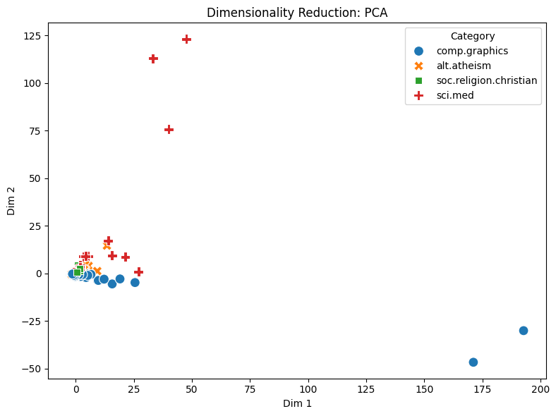

**PCA.** The first two components keep 15.57% and 7.83% of the variance, 23.40% together, so most of the information is lost in 2D. The plot shows why: almost all posts sit in one dense clump near the origin with the four categories overlapping, and the axes are set by a few extreme posts, three `sci.med` posts far up on Dim 2 (about 75–125) and two `comp.graphics` posts far out on Dim 1 (about 170–190). These are most likely the very long posts from section 2. On raw counts, PCA follows post length and a few outliers, not topic.

#### `reduce_dim_25`: t-SNE

- Components (`n_components`): 2
- Total samples (`total_samples`): 1,000
- Explained variance ratio: None (t-SNE preserves local distances rather than global variance)

2D coordinates preview (first 20 documents):

```text
[[-3.7492, 4.6177], [-19.4784, 15.0691], [2.6452, -12.9598], [25.9990, -11.0134], [5.1445, -2.6545], [-9.9751, 7.5158], [9.5027, -10.0989], [1.9720, -3.0090], [16.8527, -7.5495], [1.3316, 1.2742], [1.6871, -14.6701], [22.6292, -9.6964], [1.7388, -1.3964], [-2.3650, -4.9803], [12.1433, -4.1360], [-3.2080, 20.9332], [4.7666, -0.8072], [-26.2830, 7.8333], [18.5356, -5.1634], [8.6415, 12.3372]]
```

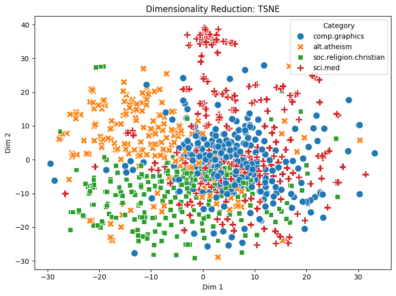

**t-SNE.** (No explained-variance ratio: t-SNE is non-linear and has no variance-preserving axes.) The categories now occupy their own regions: `alt.atheism` upper left, `soc.religion.christian` along the bottom left, `comp.graphics` a dense block in the centre-right, and `sci.med` spread around with a tight cluster at the top. The two religion groups sit next to each other and mix along their border, as expected. Distances between regions in t-SNE are not meaningful, only the neighbourhoods.

#### `reduce_dim_26`: UMAP

- Components (`n_components`): 2
- Number of neighbors (`n_neighbors`): 15
- Total samples (`total_samples`): 1,000
- Explained variance ratio: None

2D coordinates preview (first 20 documents):

```text
[[-7.2817, 0.4316], [-6.2547, 2.7100], [-6.8489, -0.7634], [-7.0179, -0.2544], [-7.1929, -1.8078], [-5.6616, 0.1067], [-7.4463, -0.8112], [-7.3560, -0.8144], [-6.8379, -1.4743], [-8.2539, 0.4191], [-7.1527, -0.5369], [-8.6128, 0.3974], [-6.9951, -0.1951], [-6.3882, -0.9560], [-7.5061, -0.9882], [-7.0633, 1.8521], [-7.3873, -1.2996], [-5.2115, 1.5056], [-7.0901, -1.1792], [-8.0691, 1.3215]]
```

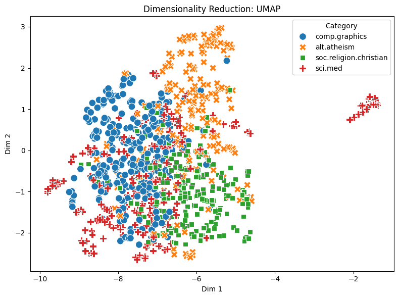

**UMAP.** UMAP shows a similar picture with tighter groups: `comp.graphics` on the left, `alt.atheism` in the upper right, `soc.religion.christian` in the lower right, and `sci.med` spread through the middle and bottom, plus a separate small `sci.med` island on the far right. That island is probably a set of very similar posts (for example one thread or a repeated announcement). UMAP keeps more of the global layout than t-SNE, so the religion groups being adjacent is meaningful here.

**Takeaway.** Linear PCA on raw counts does not separate the topics, but t-SNE and UMAP do, apart from the expected overlap between the two religion groups. The topic signal is there in the word counts, but spread over many dimensions and only visible with non-linear methods.

### 8. Labels and document similarity

Last, I one-hot encoded the labels and compared a few documents with cosine similarity, to check whether posts in the same category share more vocabulary.

#### `binarize_27`

- Number of samples (`n_samples`): 1,000
- Number of classes (`n_classes`): 4
- Classes (`classes`): `alt.atheism`, `comp.graphics`, `sci.med`, `soc.religion.christian`

Binarized labels preview (first 10 rows):

| Row | Binarized label | Category |
|---:|---|---|
| 0 | `[0, 1, 0, 0]` | comp.graphics |
| 1 | `[1, 0, 0, 0]` | alt.atheism |
| 2 | `[1, 0, 0, 0]` | alt.atheism |
| 3 | `[0, 0, 0, 1]` | soc.religion.christian |
| 4 | `[0, 0, 0, 1]` | soc.religion.christian |
| 5 | `[1, 0, 0, 0]` | alt.atheism |
| 6 | `[0, 0, 0, 1]` | soc.religion.christian |
| 7 | `[0, 0, 0, 1]` | soc.religion.christian |
| 8 | `[0, 0, 0, 1]` | soc.religion.christian |
| 9 | `[0, 1, 0, 0]` | comp.graphics |

Recommended document index pairs:

- Same category (alt.atheism): `doc_id_1` = 1 and `doc_id_2` = 2 (both are alt.atheism posts discussing genocide/religion).
- Same category (soc.religion.christian): `doc_id_1` = 3 and `doc_id_2` = 4.
- Different categories (comp.graphics vs. alt.atheism): `doc_id_1` = 0 and `doc_id_2` = 1.

#### Cosine similarity

| Result ID | Pair | Doc 1 | Doc 2 | Cosine similarity |
|---|---|---|---|---:|
| `cosine_28` | Same category (alt.atheism) | Index 1: "From: bobbe@vice.ICO.TEK.COM (Robert Beauchaine) Subject: Re: Genocide is Caused by Theism : Evidenc..." | Index 2: "From: naren@tekig1.PEN.TEK.COM (Naren Bala) Subject: Re: Genocide is Caused by Atheism Organization:..." | 0.116 |
| `cosine_29` | Same category (soc.religion.christian) | Index 3: "From: whheydt@pbhya.pacbell.com (Wilson Heydt) Subject: Re: Ancient Books Organization: Pacific * Be..." | Index 4: "From: Petch@gvg47.gvg.tek.com (Chuck Petch) Subject: Daily Verse Organization: Grass Valley Group, G..." | 0.0923 |
| `cosine_31` | Different categories (comp.graphics vs. alt.atheism) | Index 0: "From: echen@burn.ee.washington.edu (Ed Chen) Subject: Windows BMP to Sun raster or others? Article-I..." | Index 1: "From: bobbe@vice.ICO.TEK.COM (Robert Beauchaine) Subject: Re: Genocide is Caused by Theism : Evidenc..." | 0.0363 |

**Interpretation.** One-hot encoding turns the label into four 0/1 columns, one per category, so no false order is implied between categories, and each column can serve as the one-vs-rest indicator used by the correlation filters. Cosine similarity ranges from 0 (no shared words) to 1 (identical word proportions) for count vectors. The two same-category pairs (0.116 and 0.0923) score higher than the cross-category pair (0.0363), as expected, but all values are low. The 0.116 pair is two replies in the same thread ("Genocide is Caused by …"), so part of their similarity is the shared subject line, and every post shares some header words. Three pairs can't support a general claim.

### 9. Conclusions and limitations

**Answer to the question.** Yes, with caveats. Word counts carry enough topic information that t-SNE and UMAP place each newsgroup in its own region (`reduce_dim_25`, `reduce_dim_26`), and the filters find clear topic vocabularies ("graphics", "3d", "gif" for `comp.graphics`; "hiv", "aids", "cancer" for medicine). The two religion groups overlap, as expected for groups discussing the same subject from opposite sides. Linear PCA does not separate the topics (`reduce_dim_24`), because a few very long posts dominate it.

**The biggest issue is the email headers.** "edu", "subject", "lines", "organization", "nntp" and "host" dominate term frequency (`term_frequency_10`), leak into the Pearson list (`pearson_16`) and make up most of the mined patterns (`patterns_20`–`23`, `patterns_4`–`8`).

**Limitations.**

- A 1,000-post sample (representative, but smaller).
- Headers left in the text.
- Raw counts rather than tf-idf weights in the matrix.
- Pattern mining on one category only, with `min_sup` chosen by pattern count.
- Only three cosine pairs.

**Next steps.** Strip headers and quoted replies before vectorising, use tf-idf, and mine every category to compare their patterns.

## References

- scikit-learn: `CountVectorizer` and stop words. https://scikit-learn.org/stable/modules/feature_extraction.html#stop-words
- van der Maaten, L., & Hinton, G. (2008). Visualizing Data using t-SNE. *JMLR*, 9, 2579–2605. https://www.jmlr.org/papers/v9/vandermaaten08a.html
- Wattenberg, M., Viégas, F., & Johnson, I. (2016). How to Use t-SNE Effectively. *Distill*. https://distill.pub/2016/misread-tsne/
- McInnes, L., Healy, J., & Melville, J. (2018). UMAP: Uniform Manifold Approximation and Projection for Dimension Reduction. https://arxiv.org/abs/1802.03426
- PAMI: PAttern MIning library. https://github.com/UdayLab/PAMI
