# Homework Report: Pham Minh Tam (R14C42023)

## Report

I used the agent pipeline to test an idea from behavioral finance on Reddit stock posts: if investors are loss-averse, negative sentiment should be more common, and perhaps more intense, than positive sentiment. The dataset (847 posts, `load_dataset_1`) is already skewed that way: 315 negative, 423 neutral and only 109 positive posts. It had no missing values (`check_missing_3`) but 23 duplicated texts; dropping every copy (`check_duplicates_6`) left 813 posts and removed rows only from the neutral and positive classes (`describe_data_7`). Text lengths are short and heavily right-skewed (median about 80 characters, maximum 2,753).

I ran the matrix-based steps twice. In run 1 the document-term matrix kept English stop words (`build_dtm_8`: 4,313 terms, 99.52% sparse), and almost every subsequent analysis was dominated by them: the top 20 terms (`term_frequency_9`), the highest-variance terms (`variance_11`, `variance_13`) and 35 of the 40 terms in the correlation heatmap (`feature_corr_18`) were stop words such as "the", "to" and "and". Run 2 rebuilt the matrix with `stop_words="english"` (`build_dtm_21`). Removing only 241 terms (5.6% of the vocabulary) removed 43% of all non-zero entries, and the top terms became topical: "trump", "china", "market", "tariffs", "money" (`term_frequency_22`). Stop words also produced most of the run 1 cosine similarities: after removal, every one of my six document pairs dropped to 0.02 or less (`cosine_33`–`cosine_38`, run 2).

The supervised filters show what separates the classes. Words correlated with negative posts are political and emotional: "trump", "china", "economy", "trade", "americans", "trust" and swear words (`pearson_14`, `spearman_16`). Words correlated with positive posts come largely from a few promotional posts ("main", "tldr", "points", "technology", "potential", "waves"; `pearson_15`). The positive filter keeps about twice as many words (693 vs 355) mainly because of class imbalance: in a class of only 107 posts, a word that appears in a single positive post already clears the 0.05 threshold. Pattern mining on the negative class (`patterns_19`–`patterns_28`) found almost only single words, with the highest support of 42 of 315 posts ("trump", "just" under tf-idf filtering). Short comments rarely share word combinations, so frequent-pattern mining adds little beyond word counts on this data.

The 2D projections confirm that raw word counts are a weak sentiment signal. Run 1 PCA kept 26.7% of the variance on its first component (`reduce_dim_29`), but that axis mostly tracks long posts; after stop-word removal the first two components keep only 6.62% and 3.53% (`reduce_dim_30`, run 2). In all six PCA, t-SNE and UMAP plots (both runs) the negative, neutral and positive points are fully mixed; the few small groups that do form are near-identical posts, not sentiment classes.

Overall, the data is consistent with a loss-aversion story (negative posts outnumber positive ones almost 3 to 1), but it does not prove it. The negative posts are mostly about politics and trade policy; loss words ("lost", "loss", "dump", "fell") are associated with negative posts (`pearson_25`, run 2) but rank well below "trump", "china" and "economy", and "lost" appears in only 6 negative posts (`patterns_22`). The labelling and collection method are unknown, and the positive class is small. Better text cleaning (Reddit artefacts such as `x200b`), weighting (tf-idf) and a larger labelled sample would be the next steps.

---

## Result log

### 0. Research question and how the steps connect

One backbone of behavioral finance is loss aversion: people feel a loss roughly twice as strongly as a gain of the same size (Kahneman & Tversky, 1979; Tversky & Kahneman, 1992). My question is whether this shows up in how retail investors write about stocks on Reddit: are negative posts more common than positive ones, and do they use different words, such as words about losing money?

The analysis follows this chain:

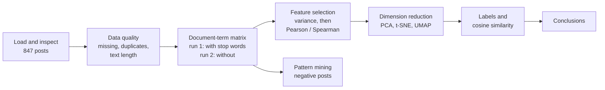

**Two runs.** In run 1 I built the document-term matrix without removing stop words. Because the function words dominated the results, I restarted the kernel and, in run 2, rebuilt the matrix with `stop_words="english"` and reran only the steps that depend on the matrix (the cleaning steps, labels and pattern mining do not). Result IDs restart after a kernel restart, so the same ID can mean different things in the two runs (for example `cosine_33`); run 2 IDs are always marked **(run 2)**.

My first attempt at run 2 (IDs `build_dtm_2` to `cosine_19`) skipped the duplicate drop and ran on 847 posts, so it was not comparable with run 1. I redid it from `check_duplicates_20` (813 posts), and this report uses only run 2 IDs `_20` to `_38`. The false start was still informative: with the duplicates in, "market" occurred 111 times; without them, 72. The duplicated posts were most likely repeated market-update posts, which shows how duplicates inflate word counts.

### 1. The data: source and limits

`newdataset/Reddit-stock-sentiment.csv`: 847 Reddit posts and comments about stocks, each labelled `-1.0` (negative), `0.0` (neutral) or `1.0` (positive). Counts per label are in section 2.

The dataset comes with no documentation: there is no information on which subreddits were scraped, the time period, or how the sentiment labels were assigned (by people, by a model, or by the posters). The content points to stock subreddits such as r/wallstreetbets: ticker talk, options slang ("calls", "puts"), "TLDR" summaries and frequent swearing.

This limits the interpretation. The class balance (more negative than positive posts) could reflect investor psychology, but it could equally reflect how the posts were sampled or labelled, or a bearish time period. The frequent "tariffs" and "china" in section 3 suggest the posts come from a period of trade-war news, which by itself would push sentiment negative.

### 2. Data quality: is the data usable as it is?

Before mining anything I checked three things that would distort later results: missing text or labels (rows that cannot be used), duplicated posts (which inflate word counts and pattern support), and very long posts (which can dominate a count-based vocabulary).

#### `load_dataset_1`

Dataset `newdataset/Reddit-stock-sentiment.csv`, loaded with `text_column="text"`, `label_column="label"`: 847 documents in total.

| Category (`category_name`) | Sentiment | Documents |
|---|---|---:|
| `-1.0` | Negative | 315 |
| `0.0` | Neutral | 423 |
| `1.0` | Positive | 109 |
| **Total** | | **847** |

#### `inspect_data_2`

- Shape: 847 rows × 3 columns
- Columns and data types:

| Column | Type | Meaning |
|---|---|---|
| `text` | object | the Reddit post or comment |
| `category_name` | object | original sentiment label as a string |
| `category` | int64 | 0-indexed class ID: 0 = `-1.0`, 1 = `0.0`, 2 = `1.0` |

First rows:

| | text | category_name | category |
|---:|---|---|---:|
| 0 | Calls on retards | -1.0 | 0 |
| 1 | Stunt as in like why did they even make a big ... | 0.0 | 1 |
| 2 | Seeing lots of red in the ticker. | 0.0 | 1 |
| 3 | Vision Marine Technologies Inc. is rewriting t... | 1.0 | 2 |
| 4 | He didn’t say thank you. | -1.0 | 0 |

#### `check_missing_3`

- Total documents: 847
- Missing count (`text` column): 0
- Missing percentage: 0.0%
- Rows with any missing values: 0

#### `check_duplicates_4`

- Initial row count: 847
- Duplicates found: 23
- Duplicate indices: 42, 349, 352, 387, 432, 438, 462, 473, 520, 541, 583, 588, 595, 679, 680, 697, 712, 717, 783, 786, 802, 836, 844
- Dropped: False
- Remaining row count: 847

#### `check_duplicates_6`

- Initial row count: 847
- Duplicates found: 23
- Dropped: True
- Remaining row count: 813

#### `describe_data_5` (before) and `describe_data_7` (after)

Text length per document (characters).

| Group | Count | Mean | Std Dev | Min | 25% | 50% (Median) | 75% | Max |
|---|---:|---:|---:|---:|---:|---:|---:|---:|
| **All, before** | 847 | 148.68 | 240.70 | 1 | 40.0 | 79.0 | 162.5 | 2753 |
| **All, after** | 813 | 148.31 | 241.43 | 1 | 39.0 | 80.0 | 165.0 | 2753 |
| `-1.0` before | 315 | 153.74 | 192.13 | 4 | 47.5 | 96.0 | 184.5 | 2040 |
| `-1.0` after | 315 | 153.74 | 192.13 | 4 | 47.5 | 96.0 | 184.5 | 2040 |
| `0.0` before | 423 | 140.79 | 258.24 | 1 | 33.0 | 68.0 | 142.0 | 2753 |
| `0.0` after | 391 | 139.08 | 260.46 | 1 | 30.5 | 68.0 | 141.0 | 2753 |
| `1.0` before | 109 | 164.64 | 292.15 | 4 | 48.0 | 82.0 | 167.0 | 2461 |
| `1.0` after | 107 | 166.04 | 294.71 | 4 | 48.0 | 81.0 | 167.5 | 2461 |

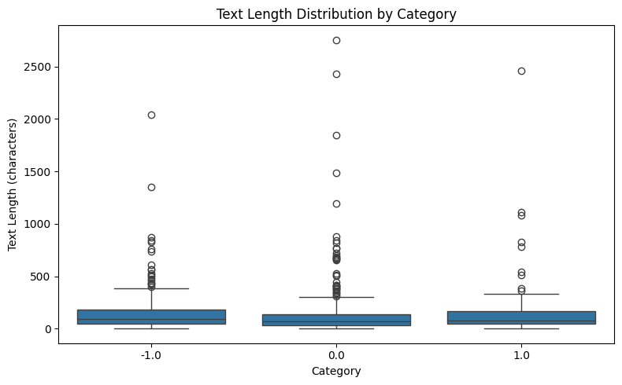

**Class balance.** Negative posts outnumber positive ones almost 3 to 1 (315 vs 109, i.e. 37% vs 13% of the posts; neutral is 50%). This fits the loss-aversion idea that losses and bad news provoke stronger reactions and therefore more posting. It is only a hypothesis here, though: with unknown sampling and labelling (section 1), the imbalance can't be attributed to investor psychology alone.

**Lengths.** All classes are strongly right-skewed: the mean (about 148 characters) is nearly twice the median (about 80), and a few posts run to 2,000–2,753 characters. Negative posts are a little longer at the median (96 characters vs 68 neutral and 81 positive, after deduplication), which would fit people writing more when upset. Positive posts have the highest mean and spread (std 294.71) because of a few long promotional posts, such as row 3 about Vision Marine.

**Decision.** There were no missing values, but 23 duplicated texts. The tool drops every copy, originals included, so 34 posts were removed (847 → 813), all from the neutral (−32) and positive (−2) classes. I dropped them before building any features, because repeated posts would inflate word frequencies and pattern support. The length statistics barely changed: the 34 removed posts averaged about 158 characters (from the totals before and after), close to the overall mean, so they were typical posts rather than outliers.

### 3. From text to features: what does the document-term matrix contain?

`CountVectorizer` turns each post into a row and each distinct word into a column, with the value being how often the word occurs in that post. I expected run 1 (no stop-word removal) to be dominated by common English words and run 2 to show the actual topics.

#### `build_dtm_8` (run 1) and `build_dtm_21` (run 2)

| | Run 1: `build_dtm_8` (no stop words) | Run 2: `build_dtm_21` (`stop_words="english"`) |
|---|---|---|
| Documents | 813 | 813 |
| Terms (vocabulary) | 4,313 | 4,072 |
| Non-zero elements | 16,659 | 9,506 |
| Total elements | 3,506,469 | 3,310,536 |
| Sparsity | 99.5249% | 99.7129% |
| First 10 terms | `00`, `000`, `01378`, `02`, `027`, `03`, `06`, `08`, `10`, `100` | not printed |

Both matrices are more than 99.5% zeros: a typical post uses only about 20 distinct terms in run 1 (16,659 non-zero entries / 813 posts), against a vocabulary of over 4,000. The vocabulary also starts with number tokens (`00`, `000`, `01378` …), because the default tokenizer keeps any alphanumeric token of 2 or more characters; prices, dates and tickers all become features.

Removing stop words took out only 241 terms (5.6% of the vocabulary) but 43% of the non-zero entries (16,659 → 9,506), leaving about 12 distinct terms per post. Stop words are few as types but appear in almost every post, which is exactly why they dominate count-based statistics. Sparsity therefore rises from 99.52% to 99.71% (this is the same effect Master Q4 asks about).

#### `term_frequency_9` (run 1) and `term_frequency_22` (run 2)

| Rank | Run 1: `term_frequency_9` | Count | Run 2: `term_frequency_22` | Count |
|---:|---|---:|---|---:|
| 1 | the | 874 | just | 95 |
| 2 | to | 554 | trump | 92 |
| 3 | and | 471 | like | 83 |
| 4 | is | 386 | china | 72 |
| 5 | it | 338 | market | 72 |
| 6 | of | 299 | think | 52 |
| 7 | in | 278 | people | 51 |
| 8 | that | 220 | going | 50 |
| 9 | for | 209 | good | 46 |
| 10 | this | 209 | money | 46 |
| 11 | you | 195 | tariffs | 39 |
| 12 | on | 167 | make | 36 |
| 13 | are | 151 | time | 36 |
| 14 | they | 148 | want | 35 |
| 15 | be | 132 | don | 34 |
| 16 | he | 132 | doing | 32 |
| 17 | will | 127 | company | 29 |
| 18 | with | 124 | right | 29 |
| 19 | if | 119 | silver | 28 |
| 20 | as | 111 | stock | 28 |

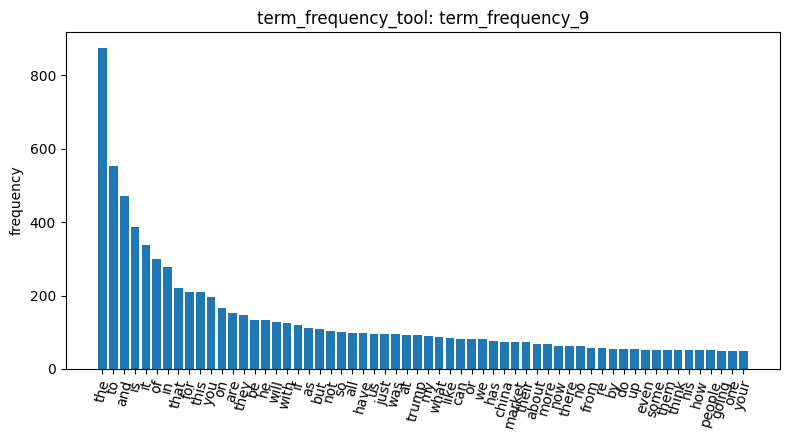

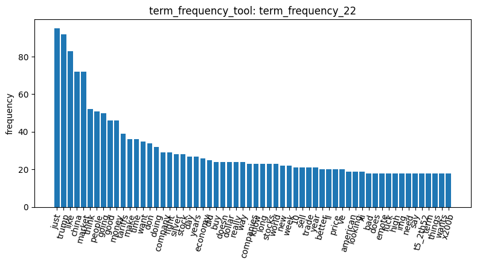

Run 1's top 20 are all function words ("the", "to", "and", "is" …). They appear in every kind of post and say nothing about sentiment, and because variance and correlation are computed on raw counts, they also dominate the later filters. In run 2 the list becomes topical: politics and macro news ("trump", "china", "tariffs", "market", "money", "stock", "silver") mixed with informal discussion words that are not in scikit-learn's stop-word list ("just", "like", "think", "going", "don" from "don't"). The plots show the long-tail (Zipf-like) shape in both runs. In run 1 the curve is very steep: "the" alone (874) is far above everything else. In run 2 the top is flatter (95, 92, 83 …) and levels off around 18–20 occurrences, and the tail of the top 60 already contains Reddit artefacts: `x200b` (Reddit's code for a blank line), `img`, `emote` and `t5_2th52` (an internal subreddit ID). Stop-word removal does not clean these.

#### `dtm_heatmap_10`

A 20 × 20 slice of the matrix: the first 20 documents × first 20 terms. All 20 terms are numbers (`00` … `118`). Only three cells are non-zero: document index 3, term `116` = 3; index 9, term `10` = 1; index 13, term `10` = 2.

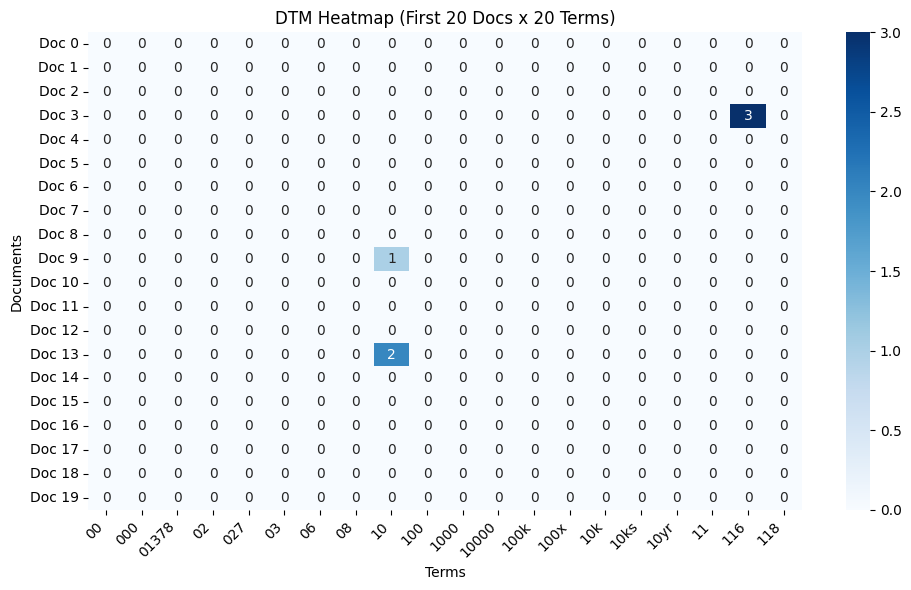

Only 3 of the 400 cells in this slice are non-zero (0.75%), which illustrates the sparsity in the table above. The slice is not representative of the vocabulary: it is the first 20 terms in alphabetical order, which are all numbers, and the only hits come from the Vision Marine post ("116 mph") and two posts mentioning "10". I did not rerun it in run 2, because the stop-word list contains no numbers, so the first 20 terms and this slice are identical.

**Decision.** Run 1 showed that without stop-word removal the matrix mostly measures how many common English words a post contains, which roughly means how long it is. That is why I rebuilt it with `stop_words="english"` for run 2, expecting the variance and correlation filters, the projections and the similarities to reflect content words instead.

### 4. Feature selection: which words carry information?

I first used an unsupervised filter (variance: which words vary across posts at all, without using the labels), then supervised filters (Pearson and Spearman correlation with a one-vs-rest sentiment label), then looked at how the top words correlate with each other.

#### Variance filter

| Result | Threshold | Kept | Removed |
|---|---:|---:|---:|
| `variance_12` | 0.0 | 4,313 | 0 |
| `variance_11` | 0.01 | 490 | 3,823 |
| `variance_13` | 0.05 | 93 | 4,220 |
| `variance_23` (run 2) | 0.01 | 340 | 3,732 |
| `variance_24` (run 2) | 0.05 | 25 | 4,047 |

Run order was 0.01, then 0.0, then 0.05, hence the IDs. In run 1 the top 20 kept terms are the same at every threshold: `the`, `to`, `and`, `is`, `you`, `of`, `in`, `it`, `for`, `that`, `will`, `this`, `they`, `are`, `he`, `on`, `with`, `as`, `be`, `not`.

Removed, preview:
- `variance_11` (0.01): `assets`, `april`, `note`, `uk`, `cut`, `removed`, `energy`, `future`, `stupid`, `half`, `almost`, `himself`, `mostly`, `wsb`, `biggest`, `due`, `dollars`, `falling`, `dumb`, `easily`
- `variance_13` (0.05): `stocks`, `system`, `analysis`, `industry`, `only`, `silver`, `down`, `world`, `our`, `ev`, `could`, `want`, `get`, `airlines`, `charging`, `evgo`, `wants`, `stock`, `water`, `over`

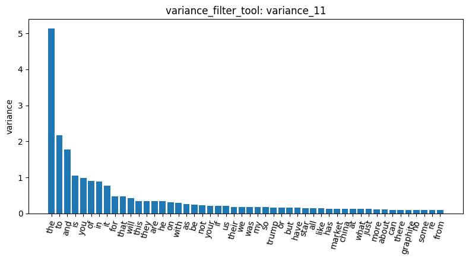

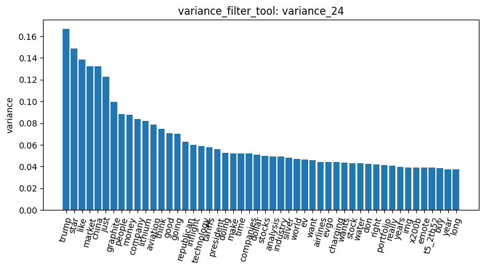

Variance on raw counts mostly rewards frequent words, since a word that occurs in many posts with varying counts has a high variance. In run 1 this meant the filter kept function words and threw away finance words: at 0.05, "stock", "stocks", "analysis" and "industry" were removed while "the", "to" and "and" were kept. So variance filtering on raw counts is not a good informativeness filter here.

In run 2 the thresholds keep fewer words (340 and 25). The top terms by variance are the first terms of `feature_corr_29` below ("trump", "star", "like", "market", "china", "just", "graphite", "people", "money", "company", "lithium", "aviation" …). Besides frequent words, variance now also rewards bursty words: "graphite", "lithium", "aviation" and "inflight" are probably repeated many times inside a few long company posts, which gives them a high variance even though few posts use them. The two run 2 plots look identical because the chart ranks every term by variance; the threshold only moves the cut-off (at 0.05 it falls after about the 25th term, around 0.05 on the y-axis). Their top 50 also contain `x200b`, `emote` and `t5_2th52`, so the variance filter keeps Reddit artefacts as "informative" words.

#### Correlation with sentiment (Pearson and Spearman)

I chose `-1.0` (negative) as the main target because of the loss-aversion hypothesis: if losses provoke stronger reactions, negative posts should have their own distinctive vocabulary. I also ran `1.0` (positive) as a contrast. Comparing what drives each sentiment is more informative than looking at one side alone.

All four runs: one-vs-rest, threshold 0.05, 4,313 features; Spearman with `max_terms=None`.

| Result | Method | Target | Kept | Removed |
|---|---|---|---:|---:|
| `pearson_14` | Pearson | `-1.0` | 355 | 3,958 |
| `pearson_15` | Pearson | `1.0` | 693 | 3,620 |
| `spearman_16` | Spearman | `-1.0` | 362 | 3,951 |
| `spearman_17` | Spearman | `1.0` | 696 | 3,617 |
| `pearson_25` (run 2) | Pearson | `-1.0` | 308 | 3,764 |
| `pearson_26` (run 2) | Pearson | `1.0` | 667 | 3,405 |
| `spearman_27` (run 2) | Spearman | `-1.0` | 303 | 3,769 |
| `spearman_28` (run 2) | Spearman | `1.0` | 665 | 3,407 |

Top 20 kept terms by absolute correlation, run 1:

| Rank | pearson_14 (`-1.0`) | spearman_16 (`-1.0`) | pearson_15 (`1.0`) | spearman_17 (`1.0`) |
|---:|---|---|---|---|
| 1 | he | he | main | technology |
| 2 | his | will | huge | huge |
| 3 | will | his | tldr | main |
| 4 | trump | trump | nice | tldr |
| 5 | fuck | fuck | technology | nice |
| 6 | china | until | potential | potential |
| 7 | him | the | perfectly | trend |
| 8 | economy | us | major | god |
| 9 | trade | him | points | perfectly |
| 10 | until | economy | god | points |
| 11 | americans | and | changing | major |
| 12 | trust | trade | vix | changing |
| 13 | us | even | ice | electric |
| 14 | point | trust | waves | rklb |
| 15 | great | americans | spot | stimulus |
| 16 | retard | retard | amd | amd |
| 17 | fucking | fucking | exciting | dividends |
| 18 | has | is | rklb | vix |
| 19 | shit | point | storms | cutting |
| 20 | literally | china | stimulus | crush |

Removed, preview:
- `pearson_14`: `investing`, `whole`, `rich`, `giving`, `nobody`, `she`, `though`, `went`, `what`, `matter`, `media`, `completely`, `nvda`, `lmk`, `hands`, `handle`, `mining`, `adding`, `executive`, `drive`
- `pearson_15`: `economy`, `do`, `his`, `why`, `will`, `better`, `didn`, `of`, `gold`, `never`, `as`, `also`, `much`, `on`, `buying`, `called`, `actually`, `seen`, `people`, `for`
- `spearman_16`: `war`, `stock`, `away`, `gme`, `understand`, `basically`, `lots`, `usd`, `government`, `giving`, `rich`, `nobody`, `whole`, `full`, `deal`, `years`, `gonna`, `fed`, `life`, `want`
- `spearman_17`: `didn`, `do`, `his`, `buying`, `wants`, `silver`, `our`, `all`, `now`, `much`, `by`, `called`, `seen`, `actually`, `president`, `usa`, `stocks`, `did`, `some`, `love`

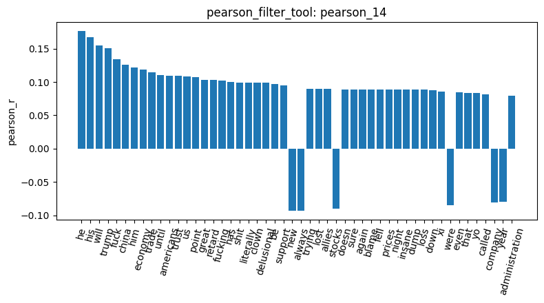

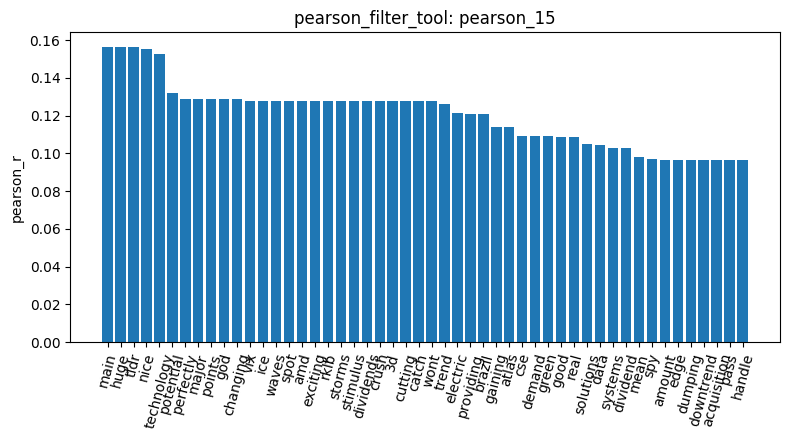

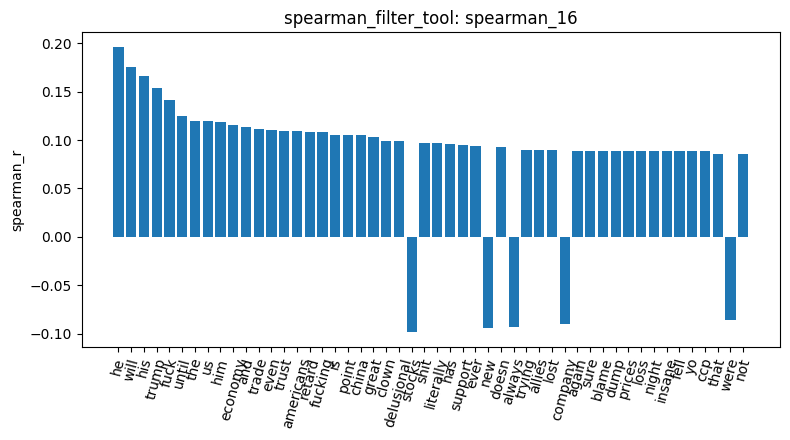

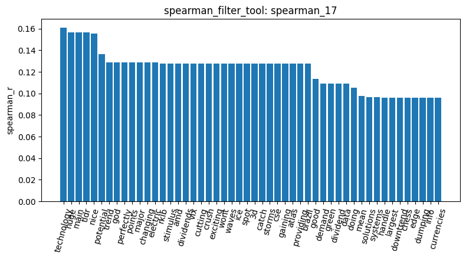

Run 2:

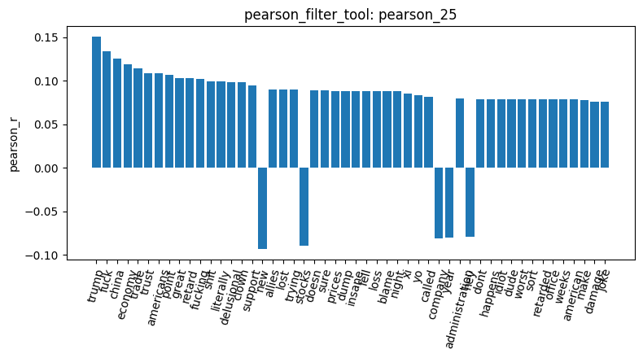

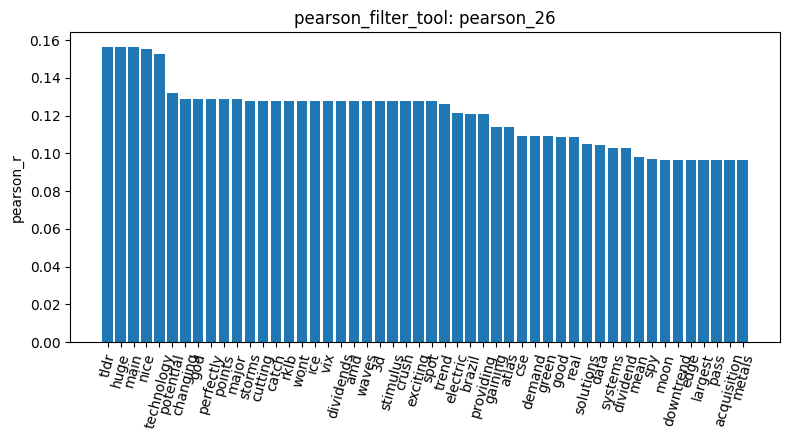

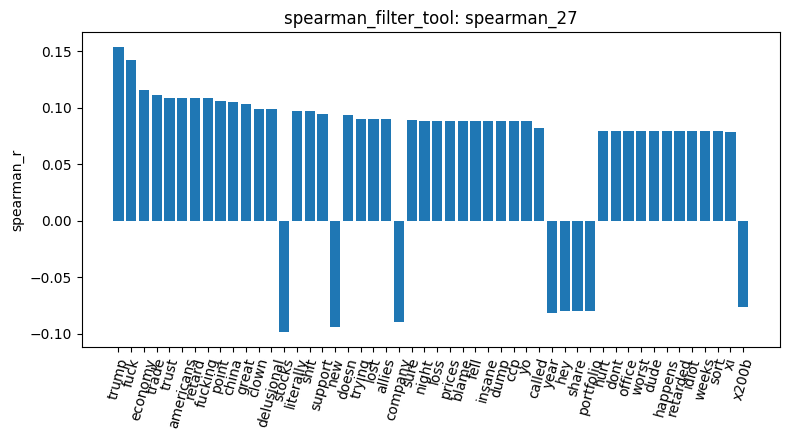

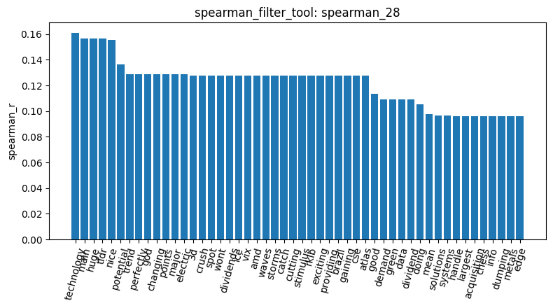

**What leads each list.** Negative posts are associated with politics, trade policy and anger: "trump", "china", "economy", "trade", "americans", "trust" and several swear words. The pronouns "he", "his" and "him" also rank at the top in run 1, which suggests that many negative posts talk about a person, most likely a politician. Positive posts are associated with hype and promotion: "huge", "nice", "potential", "technology", "exciting", "dividends", plus "main", "tldr" and "points", which come from the "Highlight Main Points … TLDR" structure of promotional posts like row 3. Pearson and Spearman agree closely on both lists.

**Why the positive filter keeps twice as many words (693 vs 355).** This is mostly class imbalance, not richer positive language. For a word that appears in exactly one post, the correlation with the class indicator is about 0.09 when that post is positive (only 107 positive posts) but about 0.044 when it is negative (315 posts). So every one-off word in a positive post clears the 0.05 threshold, and none in a negative post does.

**Run 2.** The kept counts fall by 47 for `-1.0` (355 → 308) and by 26 for `1.0` (693 → 667). Each word's correlation depends only on its own column, so the run 2 lists should be the run 1 lists minus the stop words ("he", "his", "will", "the", "and" …), and the counts are consistent with that. The run 2 bar charts show the same picture without the pronouns. For `-1.0` (`pearson_25`, `spearman_27`) the top terms are "trump", "fuck", "china", "economy", "trade", "trust", "americans", then insults ("retard", "clown", "delusional") and, lower down at about 0.09, loss words: "lost", "loss", "dump", "fell", "worst", "blame", "damage". A few words are negatively correlated (about −0.08 to −0.10): "stocks", "new", "company", "year", "hey". Neutral and positive posts talk more about specific companies and news. For `1.0` (`pearson_26`, `spearman_28`) all top 50 correlations are positive, and many bars share exactly the same value (a long plateau at about 0.128 and another at about 0.097). Identical values mean those words occur in exactly the same one or two posts, which confirms that the positive list is driven by a few promotional posts and the small class size.

#### Feature-feature correlation

`feature_corr_18`: Pearson correlation among the 40 highest-variance terms: `the`, `to`, `and`, `is`, `you`, `of`, `in`, `it`, `for`, `that`, `will`, `this`, `they`, `are`, `he`, `on`, `with`, `as`, `be`, `not`, `your`, `if`, `us`, `their`, `we`, `was`, `my`, `so`, `trump`, `or`, `but`, `have`, `star`, `all`, `like`, `has`, `market`, `china`, `at`, `what`.

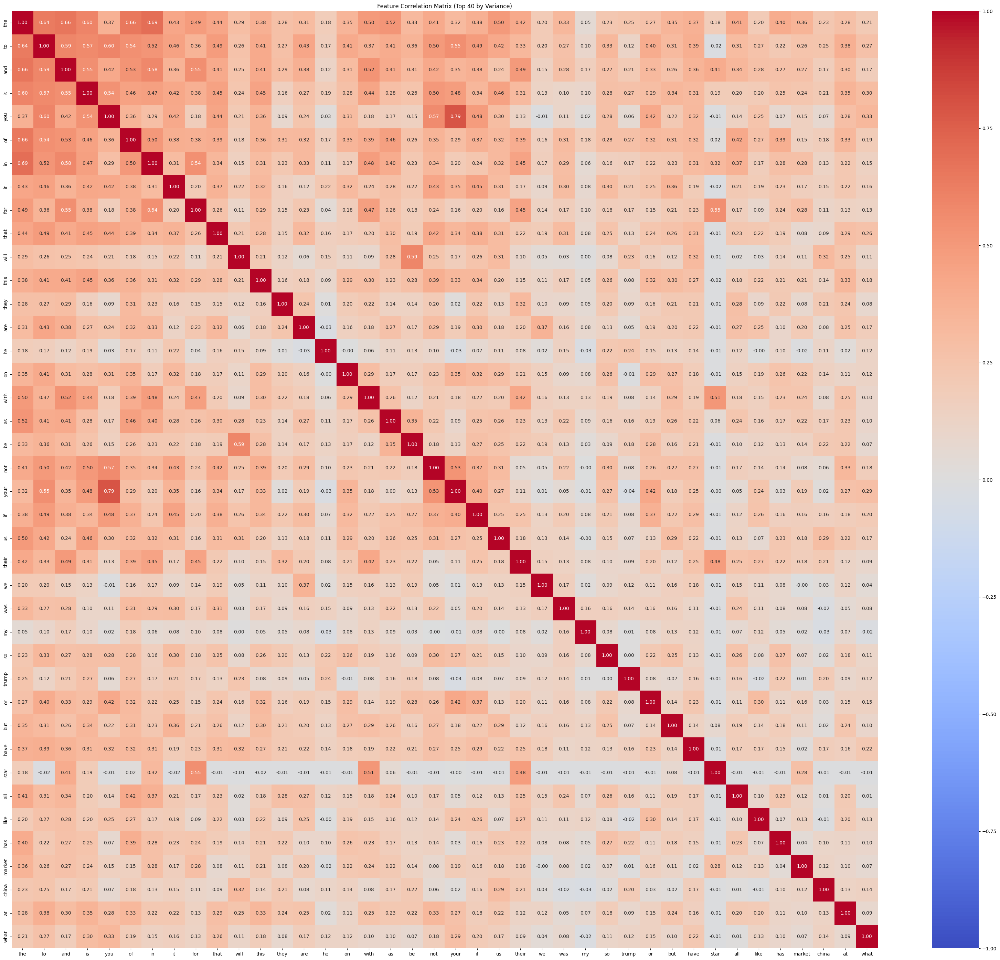

`feature_corr_29` (run 2): `trump`, `star`, `like`, `market`, `china`, `just`, `graphite`, `people`, `money`, `company`, `lithium`, `aviation`, `think`, `good`, `going`, `republican`, `inflight`, `technology`, `tariffs`, `president`, `doing`, `make`, `time`, `companies`, `dollar`, `stocks`, `analysis`, `industry`, `silver`, `world`, `ev`, `want`, `airlines`, `charging`, `evgo`, `wants`, `stock`, `water`, `don`, `right`.

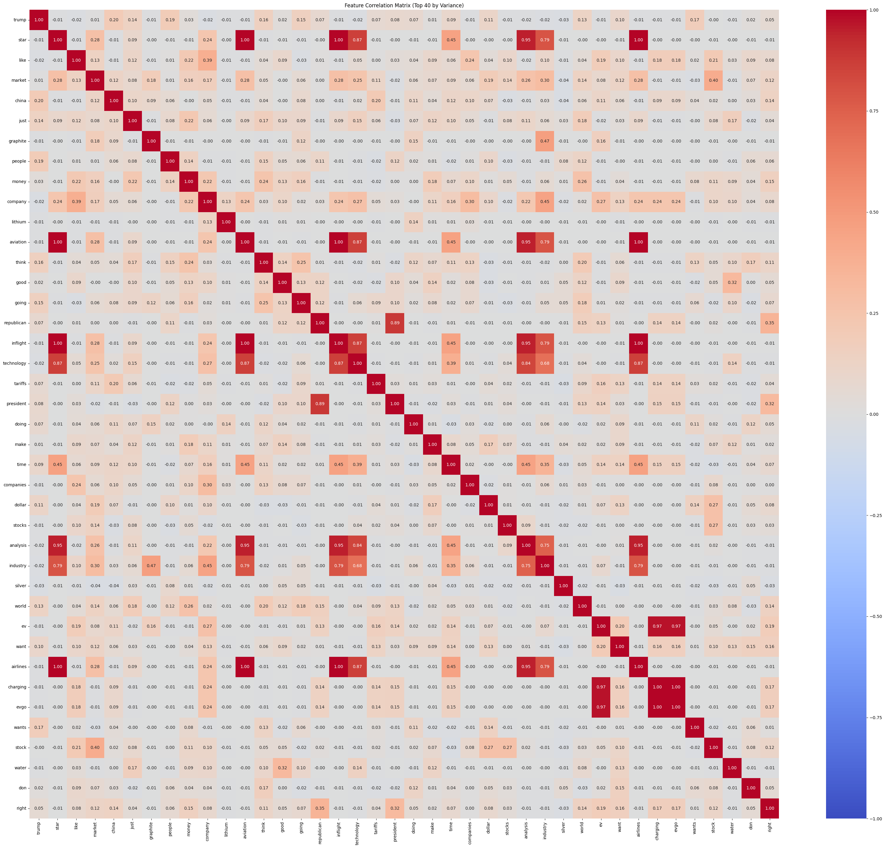

In run 1, 35 of the 40 terms are stop words; the other five are "trump", "star", "market", "china" and "like". The run 1 heatmap is warm almost everywhere: nearly every pair of function words is positively correlated (mostly 0.2–0.6, up to 0.66 for "the"–"to" and 0.79 for "you"–"your"). This reflects post length: long posts contain many of every function word, so their counts rise together. The run 2 heatmap is the opposite: almost all cells are close to 0, with a few bright blocks of near-identical words. "star", "aviation", "inflight", "airlines", "analysis", "industry" and "technology" correlate at 0.87–1.00, so they almost certainly come from one repeated company-promotion post. "ev", "charging" and "evgo" correlate at 0.97–1.00 (an EV-charging stock post), "republican"–"president" at 0.89, and "market"–"stock" at 0.40. Once stop words are gone, the remaining correlations reveal individual topics and posts, not general structure.

**Takeaway.** Without stop-word removal, every filter mainly picks up common words and post length. With it, the supervised filters do separate the classes: negative posts are about politics, trade and anger, positive posts about promotion and hype. This supports a sentiment difference, but not specifically loss aversion: the negative vocabulary is about macro news, not about losing money. Reddit artefacts survive stop-word removal (`x200b`, `img`, `emote`, `t5_2th52` in `term_frequency_22` and `variance_23`), so a real analysis would need extra cleaning beyond stop words.

### 5. Pattern mining: which words occur together in negative posts?

I mined only the negative category (315 posts), following the hypothesis: if loss aversion drives negative posts, they might contain recurring combinations such as words about losing money or bad trades. A frequent pattern is a set of words that occur together in many posts; its support is the number of posts in the category that contain every word of the set. The filtering method (variance, tf-idf or term frequency) decides which words are allowed into each post's "transaction" before mining, so it changes which patterns can appear, but not how support is counted.

`mine_patterns_tool` builds its own per-category vectorizer with `stop_words="english"` and does not use the document-term matrix, so these results already exclude stop words and were not rerun in run 2.

All runs: category `-1.0` (negative, 315 documents). `visualize_result_tool` cannot chart these results (no tabular data).

| Result | Filtering | Algorithm | min_sup / k | Patterns mined |
|---|---|---|---|---:|
| `patterns_19` | variance | fpgrowth | min_sup 3 | 233 |
| `patterns_20` | variance | fpgrowth | min_sup 4 | 122 |
| `patterns_21` | tfidf | fpgrowth | min_sup 3 | 611 |
| `patterns_22` | term_frequency | fpgrowth | min_sup 3 | 234 |
| `patterns_23` | variance | maxfpgrowth | min_sup 3 | 231 |
| `patterns_24` | tfidf | maxfpgrowth | min_sup 3 | 394 |
| `patterns_25` | term_frequency | maxfpgrowth | min_sup 3 | 232 |
| `patterns_26` | variance | topk | k 200 | 200 |
| `patterns_27` | tfidf | topk | k 200 | 200 |
| `patterns_28` | term_frequency | topk | k 200 | 200 |

Top 20 patterns, support in brackets.

**FP-Growth**

| Rank | patterns_19 (var, 3) | patterns_20 (var, 4) | patterns_21 (tfidf, 3) | patterns_22 (tf, 3) |
|---:|---|---|---|---|
| 1 | know (8) | buying (8) | just (42) | today (6) |
| 2 | country (8) | war (8) | trump (42) | stock (6) |
| 3 | trust (8) | know (8) | china (33) | moving (6) |
| 4 | war (8) | feel (8) | like (25) | puts (6) |
| 5 | buying (8) | trust (8) | think (23) | come (6) |
| 6 | feel (8) | country (8) | market (23) | lost (6) |
| 7 | need (7) | need (7) | people (23) | face (6) |
| 8 | reason (7) | doesnt (7) | going (21) | don (6) |
| 9 | better (7) | believe (7) | money (19) | went (6) |
| 10 | long (7) | worse (7) | make (18) | thats (6) |
| 11 | worse (7) | better (7) | economy (17) | guy (6) |
| 12 | did (7) | reason (7) | tariffs (16) | trying (6) |
| 13 | believe (7) | big (7) | fuck (14) | actually (6) |
| 14 | doesnt (7) | long (7) | trade (14) | calls (6) |
| 15 | big (7) | did (7) | dont (14) | lot (6) |
| 16 | guy (6) | trying (6) | time (14) | allies (6) |
| 17 | today (6) | moving (6) | good (13) | rest (6) |
| 18 | stock (6) | stock (6) | doing (13) | look (6) |
| 19 | moving (6) | today (6) | point (12) | power (6) |
| 20 | puts (6) | allies (6) | really (11) | makes (6) |

**MaxFP-Growth** (min_sup 3)

| Rank | patterns_23 (var) | patterns_24 (tfidf) | patterns_25 (tf) |
|---:|---|---|---|
| 1 | know (8) | im (9) | look (6) |
| 2 | feel (8) | know (8) | rest (6) |
| 3 | country (8) | trust (8) | makes (6) |
| 4 | war (8) | better (7) | investment (6) |
| 5 | trust (8) | did (7) | calls (6) |
| 6 | believe (7) | free (7) | lot (6) |
| 7 | did (7) | **think, market (6)** | trying (6) |
| 8 | better (7) | guy (6) | guy (6) |
| 9 | reason (7) | calls (6) | thats (6) |
| 10 | big (7) | retard (6) | went (6) |
| 11 | worse (7) | **just, make (6)** | don (6) |
| 12 | need (7) | makes (6) | lost (6) |
| 13 | long (7) | power (6) | stock (6) |
| 14 | doesnt (7) | allies (6) | today (6) |
| 15 | thats (6) | today (6) | allies (6) |
| 16 | face (6) | moving (6) | power (6) |
| 17 | look (6) | life (6) | face (6) |
| 18 | rest (6) | puts (6) | come (6) |
| 19 | makes (6) | face (6) | puts (6) |
| 20 | investment (6) | thats (6) | moving (6) |

**Top-K** (k = 200)

| Rank | patterns_26 (var) | patterns_27 (tfidf) | patterns_28 (tf) |
|---:|---|---|---|
| 1 | war (8) | trump (42) | calls (6) |
| 2 | buying (8) | just (42) | lot (6) |
| 3 | feel (8) | china (33) | actually (6) |
| 4 | know (8) | like (25) | trying (6) |
| 5 | trust (8) | think (23) | guy (6) |
| 6 | country (8) | people (23) | investment (6) |
| 7 | long (7) | market (23) | makes (6) |
| 8 | believe (7) | going (21) | rest (6) |
| 9 | big (7) | money (19) | look (6) |
| 10 | need (7) | make (18) | power (6) |
| 11 | did (7) | economy (17) | allies (6) |
| 12 | reason (7) | tariffs (16) | today (6) |
| 13 | better (7) | trade (14) | stock (6) |
| 14 | worse (7) | dont (14) | moving (6) |
| 15 | doesnt (7) | time (14) | puts (6) |
| 16 | calls (6) | fuck (14) | come (6) |
| 17 | lot (6) | good (13) | face (6) |
| 18 | actually (6) | doing (13) | thats (6) |
| 19 | trying (6) | point (12) | went (6) |
| 20 | guy (6) | literally (11) | don (6) |

**Choosing `min_sup`.** `min_sup = 3` gave 233 patterns with variance filtering; raising it to 4 roughly halved that to 122 while keeping the same top patterns. I aimed for a result above about 100 patterns, enough to interpret without a long tail of patterns found in only 3 of 315 posts (under 1%).

**Why support differs so much between filters.** With tf-idf filtering the top support is 42 ("trump", "just"; 13% of negative posts); with variance and term-frequency filtering it is only 8 and 6. The variance and term-frequency filters appear to keep a middle band of words and drop the most frequent ones, so the remaining words are each used in only a handful of posts. Tf-idf keeps the frequent topical words, so its patterns match the term-frequency results from section 3.

**FP-Growth vs MaxFP-Growth.** MaxFP-Growth keeps only maximal patterns, those with no frequent superset. For variance and term frequency it barely changes the count (233 → 231, 234 → 232), because almost every frequent pattern is a single word with no frequent word pair containing it. Only tf-idf has a few real pairs (611 → 394; "think, market" and "just, make" in the top 20). With a median post of about 80 characters, two posts rarely share two specific words.

**Top-K.** Top-K ranks patterns by support and keeps the best `k`, so its top 20 match FP-Growth for each filter. Fixing k = 200 instead of a support threshold returns a fixed number of patterns; the 200th pattern's support acts as the implied threshold.

**Takeaway for the hypothesis.** The negative patterns are about politics and trade ("trump", "china", "tariffs", "economy", "trade" under tf-idf) and about trust and conflict ("trust", "war", "country", "believe", "worse" under variance). Words about personal losses are rare: "lost" appears in 6 of 315 negative posts and "puts" in 6 (`patterns_22`), although "lost" and "loss" do correlate with the negative class (`pearson_25`). So negative sentiment in this dataset looks more like a reaction to macro news than to investors' own losses. Pattern mining adds little beyond word counts on such short texts.

### 6. Dimension reduction: do the sentiment classes separate?

After feature selection there are still over 4,000 word columns, which can't be plotted. I projected the posts to 2D with three methods: PCA (a linear projection that keeps as much global variance as possible), and t-SNE and UMAP (non-linear methods that keep local neighbourhoods; UMAP also keeps more of the global layout). Points are coloured by sentiment.

All three: `n_components=2`, `random_state=2910`; t-SNE `perplexity=30`; UMAP `n_neighbors=15` (UMAP's warning that `n_jobs` is overridden by the seed is expected).

| Result | Method | Run | Note |
|---|---|---:|---|
| `reduce_dim_29` | PCA | 1 | explained variance: PC1 26.7%, PC2 5.12% |
| `reduce_dim_30` | t-SNE | 1 | no variance ratio; plot regenerated as `reduce_dim_40` (see below) |
| `reduce_dim_31` | UMAP | 1 | no variance ratio; plot regenerated as `reduce_dim_41` (see below) |
| `reduce_dim_30` | PCA | 2 | explained variance: PC1 6.62%, PC2 3.53% |
| `reduce_dim_31` | t-SNE | 2 | no variance ratio |
| `reduce_dim_32` | UMAP | 2 | no variance ratio |

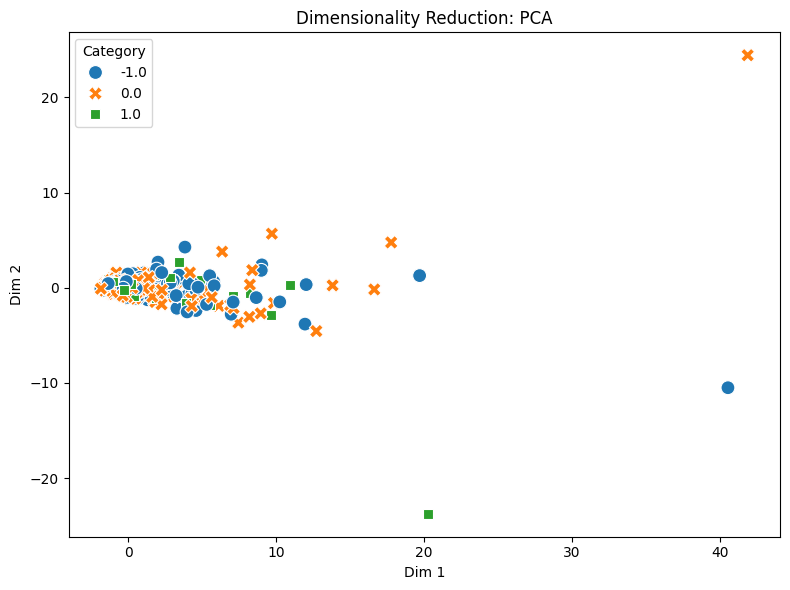

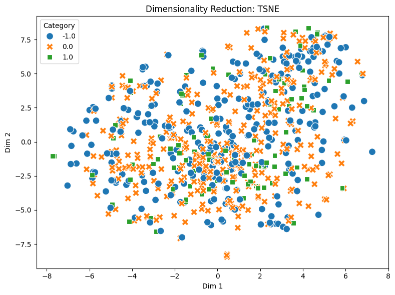

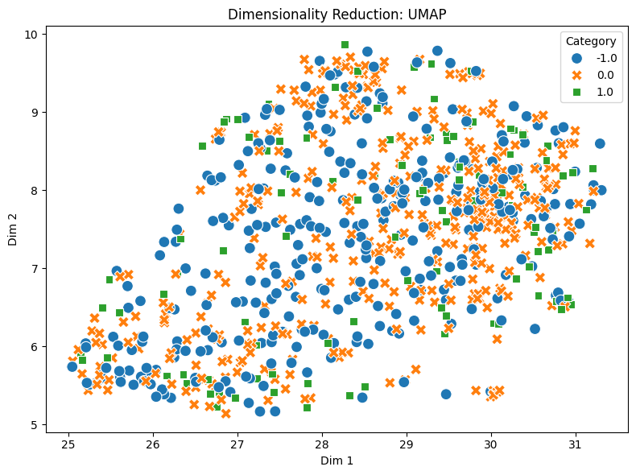

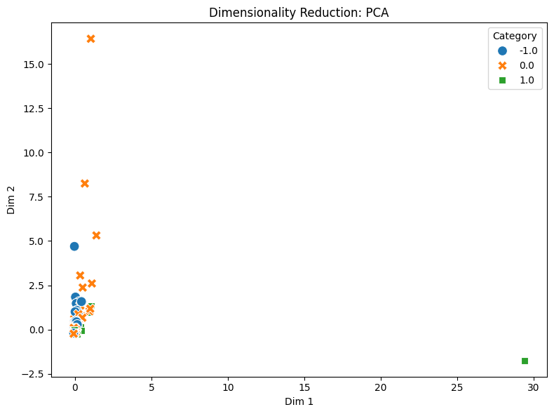

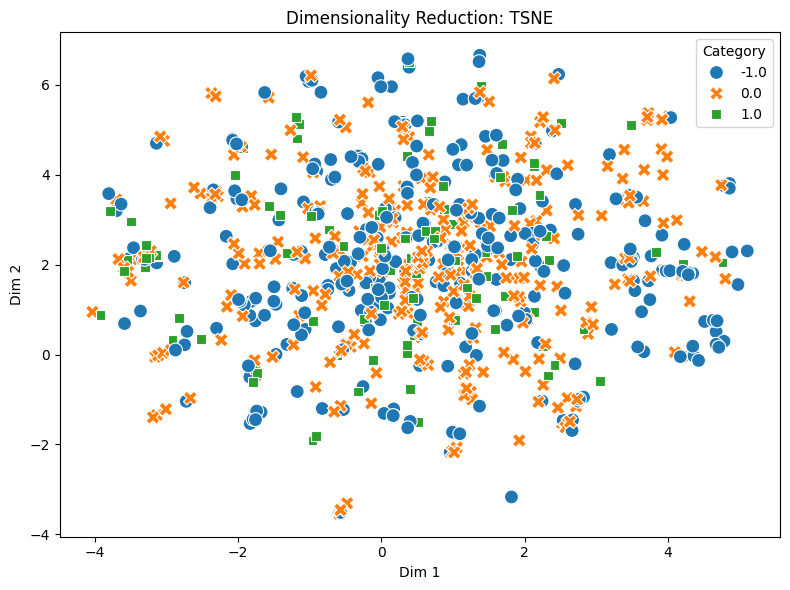

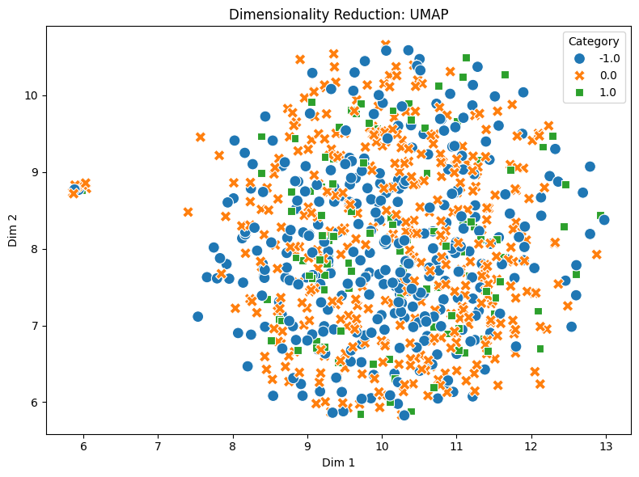

**Run 1 t-SNE and UMAP plots, regenerated.** Plot files are named by result ID, and the IDs restarted after the kernel restart, so run 2's PCA and t-SNE (`reduce_dim_30`, `reduce_dim_31`) overwrote the image files of run 1's t-SNE and UMAP. I regenerated them in the run 2 session: `build_dtm_39` rebuilt the run 1 matrix (813 posts, 4,313 terms, 16,659 non-zero, identical to `build_dtm_8`), then `reduce_dim_40` (t-SNE) and `reduce_dim_41` (UMAP) with the same parameters and seed. The first t-SNE coordinate of `reduce_dim_40` is [3.3632, -2.0652], the same as `reduce_dim_30` in run 1, so the plot is an exact reproduction.

**PCA.** In run 1 the first component explains 26.7% of the variance, which is high for text, but the plot shows what it is: almost all posts sit in a dense band near the origin, and a few long posts stretch far out along Dim 1 (up to about 40). Among the first 20 rows, the furthest out is row 3 (9.67, the long Vision Marine post), while short posts such as row 0 ("Calls on retards") sit near −1.8. With stop words in, PC1 is essentially a post-length axis, since long posts contain many of every common word. The three classes are mixed within the band. After stop-word removal, PC1 and PC2 explain only 6.62% and 3.53%: the variance is spread over many topic words and no single direction dominates. That is typical for sparse text, and it means a 2D PCA view loses most of the information. In the run 2 plot almost every post is squeezed into one point near (0, 0), and the axes are set by a handful of outliers (a neutral post at about 16 on Dim 2, a positive one at about 29 on Dim 1).

**t-SNE and UMAP.** Neither method separates the three sentiment classes in either run. Run 1 t-SNE (`reduce_dim_40`) is one broad cloud with the colours fully mixed; run 1 UMAP (`reduce_dim_41`) is an elongated diagonal band, again mixed, probably ordered by post length like PCA. In run 2 both become round, evenly mixed clouds (`reduce_dim_31`, `reduce_dim_32`). The only structure is a few tight mini-clusters, for example a small separate group of neutral and positive points at the left edge of the run 2 UMAP. These are most likely near-identical posts (repeated promotional or market-update texts), not sentiment groups. Distances between groups in t-SNE are not meaningful, so I don't read anything into how far apart they are.

2D coordinates preview, run 1 (first 20 documents):

| Row | PCA (reduce_dim_29) | t-SNE (reduce_dim_30) | UMAP (reduce_dim_31) |
|---:|---|---|---|
| 0 | [-1.7758, -0.0344] | [3.3632, -2.0652] | [28.9049, 8.0948] |
| 1 | [-0.2563, -0.5268] | [-5.6286, -3.9483] | [27.8902, 7.1520] |
| 2 | [-0.7943, -0.6427] | [2.4663, 4.7043] | [27.0342, 5.7927] |
| 3 | [9.6743, -2.8908] | [3.9047, 7.1849] | [25.4567, 5.8570] |
| 4 | [-1.6374, 0.3048] | [2.0853, -4.9345] | [29.5908, 7.9732] |
| 5 | [-1.2674, 0.12] | [-0.8933, -1.6927] | [30.3264, 8.2839] |
| 6 | [1.9848, 1.3473] | [-1.5154, 4.0623] | [27.1234, 8.4987] |
| 7 | [-0.9878, 0.1286] | [-4.6954, -0.9635] | [28.4733, 9.0889] |
| 8 | [1.9209, -1.4583] | [3.9778, 5.2488] | [26.1579, 5.6233] |
| 9 | [0.0039, 0.2829] | [-4.8855, 0.2818] | [27.3668, 9.1077] |
| 10 | [-1.6747, 0.059] | [-3.6781, -1.8297] | [28.5402, 9.3332] |
| 11 | [-1.352, -0.1568] | [-0.8105, -2.9056] | [29.9371, 8.1367] |
| 12 | [-1.1013, -0.4114] | [1.8326, 1.2794] | [28.3202, 6.5958] |
| 13 | [0.0101, 1.1062] | [4.2513, -2.0261] | [28.7245, 8.5370] |
| 14 | [-1.4384, 0.3114] | [-1.1869, 2.0553] | [28.9230, 8.3430] |
| 15 | [-1.8486, -0.1039] | [0.1222, -1.1973] | [29.8876, 7.7702] |
| 16 | [-1.8486, -0.1037] | [-0.2325, -1.8174] | [29.7562, 7.8706] |
| 17 | [5.6144, 0.2111] | [-0.7060, 6.6737] | [26.1320, 7.3356] |
| 18 | [-1.4985, -0.2424] | [-2.2218, 1.0134] | [28.7057, 7.8958] |
| 19 | [9.0276, 2.4047] | [6.0077, 6.9412] | [25.5290, 6.1206] |

**Takeaway.** In none of the six projections does sentiment form its own region. Raw word counts (even without stop words) capture topic and length better than sentiment: posts about the same stock or the same political event are closer to each other than posts with the same label. Separating sentiment would need features that carry it more directly, such as sentiment lexicons, weighting, or embeddings.

### 7. Labels and document similarity

Two last steps: encoding the labels as one-hot vectors, and checking whether posts in the same sentiment class share more vocabulary than posts in different classes (cosine similarity of their count vectors).

`binarize_32`: 813 samples, 3 classes `['-1.0', '0.0', '1.0']`, one-hot encoded. First 10 rows:

| Row | One-hot | Label |
|---:|---|---:|
| 0 | [1, 0, 0] | -1.0 |
| 1 | [0, 1, 0] | 0.0 |
| 2 | [0, 1, 0] | 0.0 |
| 3 | [0, 0, 1] | 1.0 |
| 4 | [1, 0, 0] | -1.0 |
| 5 | [0, 1, 0] | 0.0 |
| 6 | [1, 0, 0] | -1.0 |
| 7 | [0, 1, 0] | 0.0 |
| 8 | [0, 0, 1] | 1.0 |
| 9 | [0, 0, 1] | 1.0 |

Labels don't depend on the DTM, so this was not rerun in run 2.

One-hot encoding turns the single label column into three 0/1 columns, one per class. This avoids implying an order or distance between the class IDs (0, 1, 2), and it gives a separate indicator per class, which is what the one-vs-rest Pearson and Spearman filters in section 4 correlate against. The preview also served as a lookup of each row's class when I chose the cosine pairs below.

Pairs chosen from the first 10 rows: one within each category, and one for each pair of categories.

| Pair | Rows | Categories | Run 1 result | Similarity | Run 2 result | Similarity |
|---|---|---|---|---:|---|---:|
| Negative–Negative | 0 vs 4 | -1.0 / -1.0 | `cosine_33` | 0.0 | `cosine_33` (run 2) | 0.0 |
| Neutral–Neutral | 1 vs 2 | 0.0 / 0.0 | `cosine_34` | 0.2004 | `cosine_34` (run 2) | 0.0 |
| Positive–Positive | 3 vs 8 | 1.0 / 1.0 | `cosine_35` | 0.3049 | `cosine_35` (run 2) | 0.0148 |
| Negative–Positive | 0 vs 3 | -1.0 / 1.0 | `cosine_36` | 0.0585 | `cosine_36` (run 2) | 0.0 |
| Negative–Neutral | 0 vs 1 | -1.0 / 0.0 | `cosine_37` | 0.0 | `cosine_37` (run 2) | 0.0 |
| Positive–Neutral | 3 vs 1 | 1.0 / 0.0 | `cosine_38` | 0.1882 | `cosine_38` (run 2) | 0.0214 |

The documents:
- Row 0 (`-1.0`): "Calls on retards"
- Row 1 (`0.0`): "Stunt as in like why did they even make a big deal about starting it in the first place? No company should ever talk about politics ever."
- Row 2 (`0.0`): "Seeing lots of red in the ticker."
- Row 3 (`1.0`): a long post on Vision Marine Technologies' 116 mph electric-boat record
- Row 4 (`-1.0`): "He didn't say thank you."
- Row 8 (`1.0`): "Am I the only one seeing the cup & handle breakout here? 52 week high? Third Green Day? …"

Cosine similarity compares the angle between two count vectors. Because word counts are never negative, it ranges from 0 (no shared words) to 1 (the same words in the same proportions), and it does not depend on post length.

**Run 1.** Every non-zero score comes from shared function words. Rows 1 and 2 (0.2004) share only "in" and "the"; row 0 ("Calls on retards") and row 3 (0.0585) share only "on". The highest score, rows 3 and 8 (0.3049, both positive), comes from two posts that both use many common words.

**Run 2.** After stop-word removal, the shared function words disappear and every score drops to 0.0214 or below; four of the six pairs become exactly 0. The two remaining non-zero scores are a positive–positive pair (0.0148) and a positive–neutral pair (0.0214), so in this sample same-class posts are not more similar than cross-class posts.

**Takeaway.** Six pairs can't support a general claim, but the run 1 → run 2 change is clear: most of the apparent similarity between short Reddit posts was shared grammar, not shared content. The posts in this dataset hardly share any content words with each other, which is also why the patterns in section 5 are mostly single words.

### 8. Conclusions and limitations

**Answer to the question.** The data is consistent with loss aversion in one respect: negative posts outnumber positive ones almost 3 to 1 (315 vs 109, `load_dataset_1`), and negative posts are slightly longer at the median (`describe_data_7`). But the content of the negative posts does not point to personal losses. Their distinctive words are political and macroeconomic ("trump", "china", "tariffs", "economy", "trade"; `pearson_14`, `patterns_21`) and emotional (swear words, "trust"), while loss-related words are present but secondary: "lost", "loss", "dump" and "fell" correlate with the negative class at about 0.09 (`pearson_25`), against about 0.15 for "trump", and "lost" and "puts" each appear in only 6 of 315 negative posts (`patterns_22`). In this dataset, negative sentiment looks driven by news and politics more than by investors reacting to their own losses. Word-count features also do not separate the sentiment classes in 2D (`reduce_dim_29`–`32`, `40`, `41`).

**Method lessons.** Stop-word removal changed almost every matrix-based result (`build_dtm_8` vs `build_dtm_21`): without it, variance, correlation, projection and cosine similarity mostly measured common words and post length.

**Limitations.**

- Unknown collection and labelling: no subreddit, time period or labelling method is documented, so the class balance can't be attributed to investor psychology.
- A small positive class (107 posts after deduplication), which also inflates the number of words the correlation filter keeps for it.
- Very short texts (median about 80 characters), so few words are shared between posts.
- Reddit artefacts in the vocabulary (`x200b`, `img`, `emote`, `t5_2th52`, number tokens) that stop-word removal doesn't clean.
- Raw counts rather than weights, and pattern mining on the negative class only.

**Next steps.** Clean Reddit artefacts and numbers, use tf-idf weighting, mine the positive class for comparison, and test sentiment-specific features (a finance sentiment lexicon or embeddings) on a larger, documented sample.

## References

- Kahneman, D., & Tversky, A. (1979). Prospect Theory: An Analysis of Decision under Risk. *Econometrica*, 47(2), 263–291. https://doi.org/10.2307/1914185
- Tversky, A., & Kahneman, D. (1992). Advances in prospect theory: Cumulative representation of uncertainty. *Journal of Risk and Uncertainty*, 5, 297–323. https://doi.org/10.1007/BF00122574
- scikit-learn: `CountVectorizer` and stop words. https://scikit-learn.org/stable/modules/feature_extraction.html#stop-words
- van der Maaten, L., & Hinton, G. (2008). Visualizing Data using t-SNE. *JMLR*, 9, 2579–2605. https://www.jmlr.org/papers/v9/vandermaaten08a.html
- Wattenberg, M., Viégas, F., & Johnson, I. (2016). How to Use t-SNE Effectively. *Distill*. https://distill.pub/2016/misread-tsne/
- McInnes, L., Healy, J., & Melville, J. (2018). UMAP: Uniform Manifold Approximation and Projection for Dimension Reduction. https://arxiv.org/abs/1802.03426
- PAMI: PAttern MIning library. https://github.com/UdayLab/PAMI
